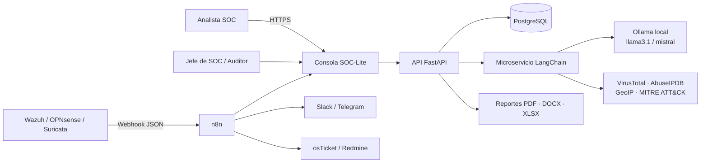
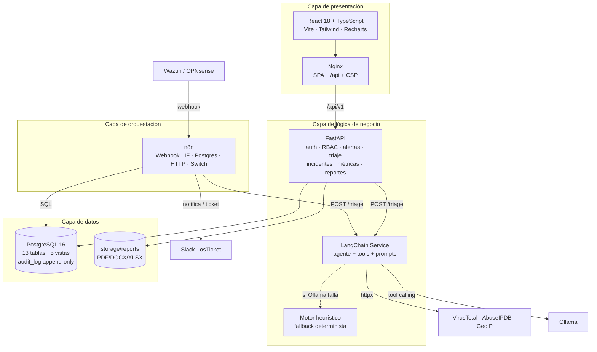
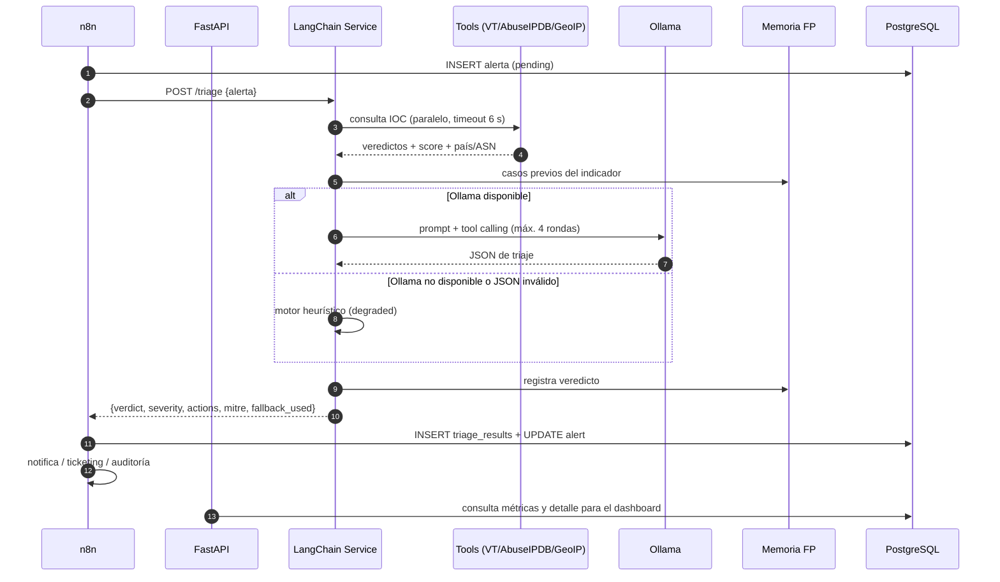
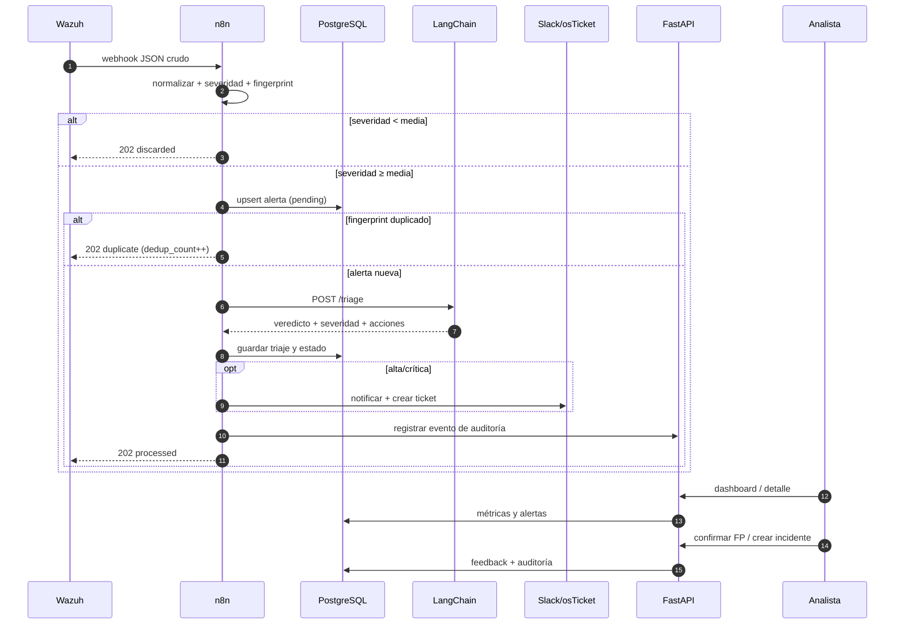
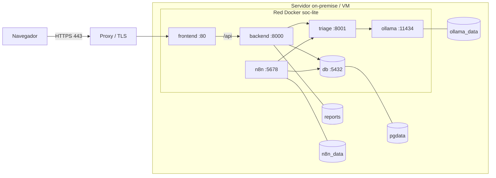

# 1. Arquitectura del sistema

> Caso de uso 1 — Triaje automático de alertas SOC («SOC-Lite»), nivel de impacto **crítico**.
> Solución orientada a PYME, mediana empresa y organismo público, desplegable on-premise.

---

## 1.1 Resumen ejecutivo

SOC-Lite convierte el flujo tradicional `SIEM → cola infinita → analista saturado` en un pipeline
`SIEM → normalización → enriquecimiento → veredicto → acción` con trazabilidad completa. La
decisión de arquitectura central es **separar la orquestación (n8n)** de la **lógica de decisión
(LangChain)** y del **sistema de registro (PostgreSQL + FastAPI)**: n8n integra, LangChain razona,
FastAPI valida y persiste, React presenta.

El sistema no intenta sustituir al analista. El agente **propone** un veredicto, una severidad y
unas acciones; el analista confirma o corrige con un clic. Esa validación alimenta la memoria de
falsos positivos y las métricas de calidad.

### Objetivos medibles

| Objetivo | Métrica | Línea base (sin SOC-Lite) | Meta |
|---|---|---|---|
| Reducir el tiempo hasta el triaje | MTTT promedio / P95 | 2–8 h | < 30 min promedio, P95 < 60 min |
| Filtrar ruido | Tasa de falsos positivos identificados | 70–90 % sin priorizar | > 70 % del ruido clasificado como benigno/FP |
| Operación continua | Cobertura horaria | 8×5 | 24×7 con escalado humano |
| Trazabilidad | Eventos auditados | Parcial | 100 % de accesos y acciones críticas |
| Evidencia normativa | Controles cubiertos | — | NIST CSF DE.AE/RS.AN/RS.MA; ISO 27001 A.8.15/A.8.16/A.5.24–A.5.28 |

### Alcance

**Dentro del alcance:** ingesta Wazuh/OPNsense/Suricata, deduplicación, enriquecimiento con
VirusTotal/AbuseIPDB/GeoIP, triaje LLM local con fallback, dashboard, alertas, incidentes,
usuarios/roles, auditoría, reportes PDF/Word/Excel, workflow n8n y despliegue Docker.

**Fuera del alcance de esta versión:** respuesta automática activa (bloqueo/aislamiento),
integración EDR bidireccional, correlación multi-tenant, firma digital de reportes, SSO/SAML,
aplicación móvil nativa. Se documentan como evolución.

---

## 1.2 Vista de contexto (C4 · nivel 1)

**Fronteras de confianza**

1. **Internet → SIEM:** tráfico no confiable; el SIEM ya aplica sus reglas.
2. **SIEM → n8n:** webhook autenticado por red interna y clave de ingesta en la API.
3. **n8n → LangChain:** red interna Docker; sin exposición pública.
4. **LangChain → proveedores externos:** sólo se envía el **indicador** (IP/dominio), nunca el
   payload completo ni nombres de activos.
5. **Usuario → consola:** JWT, RBAC y bitácora; TLS en el proxy inverso.

---

## 1.3 Vista de contenedores (C4 · nivel 2)

### Responsabilidades por capa

| Capa | Componente | Responsabilidad | No debe hacer |
|---|---|---|---|
| Presentación | React + Nginx | Visualizar, filtrar, capturar decisiones, descargar reportes | Reglas de negocio ni acceso directo a BD |
| Orquestación | n8n | Integrar, normalizar, deduplicar, enrutar, reintentar, notificar | Clasificar con LLM ni persistir lógica compleja |
| Lógica | FastAPI | Validar, autorizar, persistir, calcular métricas, generar reportes | Ejecutar acciones ofensivas o de contención |
| Lógica IA | LangChain | Enriquecer, razonar, proponer veredicto y acciones | Escribir en BD, ejecutar comandos, decidir sin validación |
| Datos | PostgreSQL | Sistema de registro, integridad, auditoría inmutable | Lógica de presentación |

---

## 1.4 Componentes

### 1.4.1 Capa de presentación

- **React 18 + TypeScript + Vite**: SPA con routing protegido por permisos.
- **Tailwind CSS**: sistema de diseño oscuro orientado a operación 24/7, con estados de
  severidad consistentes en toda la aplicación.
- **TanStack Query**: caché, reintentos y refresco de datos del servidor; separa el estado remoto
  del estado local.
- **Recharts**: tendencia diaria, distribución por severidad, top orígenes, MTTT/SLA y tasa de FP.
- **Axios con interceptor**: adjunta el JWT y renueva la sesión de forma transparente con
  rotación de refresh token; si la renovación falla, cierra sesión y redirige al login.
- **Nginx**: sirve la SPA, proxya `/api` al backend, aplica CSP y cabeceras de seguridad.

### 1.4.2 Capa de orquestación (n8n)

| Función | Implementación |
|---|---|
| Entrada | Nodo Webhook `POST /webhook/soc-lite-ingest` con `responseMode=responseNode` |
| Normalización | Nodo Code: mapea Wazuh/OPNsense, calcula severidad y huella SHA-256 |
| Filtro | Nodo IF: descarta `severity < medium` (ruido informativo) |
| Persistencia | Nodo PostgreSQL con `INSERT ... ON CONFLICT (fingerprint) DO UPDATE` |
| Deduplicación | Huella única en ventana de 15 min + contador `dedup_count` |
| Triaje | Nodo HTTP con reintentos (`maxTries=2`) al microservicio LangChain |
| Enrutamiento | Nodo Switch por severidad (alta/crítica, media, baja/info) |
| Persistencia del triaje | Nodo PostgreSQL con CTE `INSERT ... RETURNING` + `UPDATE alerts` |
| Notificación | HTTP a Slack sólo para alta/crítica |
| Ticketing | HTTP a osTicket/Redmine para alta/crítica |
| Auditoría | HTTP a `POST /api/v1/audit/events` con `X-Ingest-Key` |
| Resiliencia | Si LangChain falla, la alerta vuelve a `pending` y se audita el fallo |

El detalle nodo a nodo está en [05-workflow-n8n.md](05-workflow-n8n.md); el JSON importable en
[`n8n/soc_lite_triage_workflow.json`](../n8n/soc_lite_triage_workflow.json).

### 1.4.3 Capa de lógica (FastAPI)

| Módulo | Responsabilidad |
|---|---|
| `core` | Configuración 12-factor, JWT, bcrypt, RBAC, errores uniformes, logging JSON |
| `middleware` | `Request-ID`, cabeceras de seguridad y bitácora ENTER/EXIT por módulo |
| `models` | ORM SQLAlchemy 2 tipado, enums nativos de PostgreSQL, relaciones |
| `schemas` | Contratos Pydantic v2 de entrada/salida y validación estricta |
| `api/v1/routers` | 7 routers: auth, users, alerts, incidents, dashboard, reports, audit |
| `services` | Normalización, cliente de triaje, métricas SQL, reportes, auditoría |
| `tests` | 14 pruebas de integración contra PostgreSQL real |

**Decisiones clave del backend**

1. **Async de punta a punta** (`asyncpg` + SQLAlchemy async) para sostener I/O concurrente sin
   inflar workers.
2. **La API es la única puerta de escritura de negocio.** n8n puede escribir alertas/triajes por
   SQL por rendimiento, pero las acciones sensibles (feedback, usuarios, reportes) pasan por API.
3. **Fail-open controlado en triaje**: si el LLM no responde, se usa heurística local y se marca
   `degraded`; la alerta nunca queda sin clasificar.
4. **El agente no ejecuta**: no hay herramientas de bloqueo, aislamiento ni borrado. Las
   recomendaciones son texto estructurado que el analista decide.

### 1.4.4 Capa de datos

- **PostgreSQL 16** como sistema de registro.
- Tipos nativos: `JSONB` (payloads y acciones), `INET` (IPs), `ARRAY` (tags y MITRE),
  `ENUM` (estados), `NUMERIC` (confianza), `TIMESTAMPTZ`.
- **13 tablas**, **5 vistas**, **11 enums**, triggers de integridad y cadena de hashes.
- **`audit_log` append-only**: triggers que rechazan `UPDATE` y `DELETE`; cada fila enlaza el hash
  de la anterior.
- **Reportes**: archivos en `storage/reports` y metadatos en la tabla `reports` (autor, parámetros,
  tamaño, estado).

Ver [02-modelo-datos.md](02-modelo-datos.md).

### 1.4.5 Capa de IA (LangChain)

**Controles del agente**

| Riesgo | Control |
|---|---|
| Inyección de prompts en logs | El payload se delimita como dato no confiable; el sistema instruye a ignorar órdenes embebidas |
| Alucinación de IOCs | Las herramientas devuelven `skipped`/`error`; el prompt prohíbe inventar evidencia |
| Salida no estructurada | Validación Pydantic + reintento de reparación + fallback heurístico |
| Acciones peligrosas | El agente sólo recomienda; no tiene herramientas de ejecución |
| Fuga de datos | Ollama local por defecto; a proveedores externos sólo se envía el indicador |
| Deriva del modelo | `prompt_version` y `model` se persisten en cada triaje |

---

## 1.5 Flujo extremo a extremo

**Presupuesto de latencia** (objetivo P95 < 60 s):

| Etapa | Tiempo típico | Peor caso |
|---|---|---|
| Webhook + normalización | < 100 ms | 300 ms |
| Upsert PostgreSQL | < 50 ms | 200 ms |
| Enriquecimiento (3 APIs, timeout 6 s) | 0.5–3 s | 6 s |
| LLM local (8B, 4 rondas) | 5–25 s | 90 s |
| Persistencia + notificación | < 500 ms | 2 s |
| **Total** | **6–30 s** | **~100 s** (con fallback) |

---

## 1.6 Decisiones de arquitectura (ADR)

### ADR-01 · n8n para orquestación, no para la lógica de decisión

- **Contexto:** el equipo domina n8n; se necesita integrar Wazuh, HTTP, SQL, Slack y osTicket con
  reintentos y visibilidad operativa.
- **Decisión:** n8n orquesta el pipeline; la clasificación vive en un microservicio LangChain y la
  persistencia de negocio en FastAPI.
- **Consecuencias:** + velocidad de integración y mantenimiento por analistas; − una pieza más que
  desplegar; se mitiga con healthchecks y contrato HTTP versionado.
- **Alternativas descartadas:** todo en Python (menos visible para operación); todo en n8n
  (imposible mantener prompts, tools y tests con calidad).

### ADR-02 · LangChain en microservicio FastAPI, no LangFlow

- **Contexto:** se requiere tool calling, memoria de casos, validación de salida y control fino de
  prompts; LangFlow es excelente para prototipos visuales pero incómodo para tests y versionado.
- **Decisión:** servicio FastAPI independiente con LangChain, prompts versionados y Pydantic.
- **Consecuencias:** + testeable, versionable y desplegable por separado; − requiere conocimiento
  de Python por parte del equipo.
- **Mitigación:** el contrato `/triage` es simple y el servicio se puede reemplazar sin tocar n8n.

### ADR-03 · Ollama local por defecto, OpenAI opcional

- **Contexto:** las alertas contienen IPs internas, nombres de activos y usuarios; enviarlas a un
  proveedor cloud puede violar la política de datos.
- **Decisión:** `llama3.1:8b`/`mistral` en Ollama; el proveedor es configurable por variables.
- **Consecuencias:** + soberanía del dato y coste marginal cero; − requiere hardware (8–16 GB RAM
  o GPU) y la calidad del 8B es inferior a modelos frontier.
- **Mitigación:** fallback heurístico, revisión humana obligatoria en `inconclusive`/`suspicious`
  y posibilidad de cambiar a un modelo mayor en el mismo endpoint.

### ADR-04 · PostgreSQL con JSONB + tipos nativos

- **Contexto:** el payload del SIEM es heterogéneo; las consultas del dashboard son agregaciones
  relacionales con percentiles.
- **Decisión:** columnas tipadas para lo consultable, `JSONB` para el crudo, `INET` para IPs.
- **Consecuencias:** + integridad y rendimiento; − migraciones más cuidadosas.
- **Alternativas descartadas:** MongoDB (peor para métricas y joins); sólo texto (pierde validación).

### ADR-05 · RBAC en base de datos, no en el frontend

- **Contexto:** múltiples perfiles (admin, jefe de SOC, analista, auditor, consulta).
- **Decisión:** roles/permisos en tablas, validados por dependencia en cada endpoint; el frontend
  sólo oculta acciones.
- **Consecuencias:** + una sola fuente de verdad; − una consulta extra por request (mitigada con
  eager loading y caché de JWT).
- **Nota:** los permisos también viajan en el JWT para que la UI pinte el menú, pero **el backend
  nunca confía en ellos**: los recalcula desde la base.

### ADR-06 · Bitácora append-only con cadena de hashes

- **Contexto:** ISO 27001 A.8.15 exige registros protegidos contra alteración.
- **Decisión:** triggers que bloquean `UPDATE`/`DELETE` y hash encadenado `prev_hash + campos`,
  con una secuencia (`chain_seq`) asignada dentro del lock para preservar el orden bajo concurrencia.
- **Consecuencias:** + evidencia verificable; − crece indefinidamente (se mitiga con particionado
  y archivado, ver §1.9).
- **Limitación:** la cadena detecta alteraciones, no las impide si un atacante tiene privilegios de
  superusuario; se recomienda exportar periódicamente a WORM/S3 Object Lock.

### ADR-07 · Fail-open en triaje, fail-closed en autorización

- **Contexto:** disponibilidad 24/7 vs. seguridad.
- **Decisión:** si el LLM falla, se sigue triando con heurística; si falla la autenticación o el
  permiso, se deniega.
- **Consecuencias:** + ninguna alerta se pierde; − un triaje degradado puede requerir revisión
  humana (se marca `needs_human`).

### ADR-08 · Reportes generados en servidor

- **Contexto:** PDF/Word/Excel deben ser reproducibles y auditables, no una captura del navegador.
- **Decisión:** ReportLab, python-docx y openpyxl en el backend; archivo persistido + fila en
  `reports`.
- **Consecuencias:** + consistencia y trazabilidad; − generación síncrona de 1–3 s (aceptable;
  se puede mover a cola si crece).

---

## 1.7 Despliegue

| Servicio | Imagen | Puerto host | Persistencia |
|---|---|---|---|
| `db` | `postgres:16-alpine` | 5439 → 5432 | volumen `pgdata` |
| `backend` | build `./backend` | 8010 | volumen `reports` |
| `triage` | build `./langchain-service` | 8011 | `data/` (memoria de casos) |
| `frontend` | build `./frontend` (Nginx) | 8090 | — |
| `n8n` | `n8nio/n8n:latest` | 5679 | volumen `n8n_data` |
| `ollama` | `ollama/ollama:latest` (perfil `llm`) | 11434 | volumen `ollama_data` |

**Requisitos mínimos:** 4 vCPU, 8 GB RAM, 80 GB SSD (sin Ollama); 8 vCPU, 16 GB RAM y GPU opcional
con Ollama. Para 5 000 alertas/día el cuello de botella es el LLM, no PostgreSQL.

---

## 1.8 Seguridad y cumplimiento

### Controles técnicos

| Control | Implementación |
|---|---|
| Autenticación | JWT HS256, access 30 min, refresh 7 días con rotación y detección de reutilización |
| Contraseñas | bcrypt coste 12; política de 10+ caracteres con mayúscula, dígito y símbolo |
| Autorización | RBAC de 26 permisos, validado por endpoint; admin inmutable |
| Auditoría | ENTER/EXIT por módulo + eventos de negocio; hash chain; export CSV/XLSX |
| Integridad | Triggers append-only; restricciones `CHECK`, FKs, enums |
| Ingesta | `X-Ingest-Key` con `secrets.compare_digest`; límite de tamaño en Nginx |
| Cabeceras | CSP, `X-Frame-Options: DENY`, `nosniff`, `Referrer-Policy`, HSTS en producción |
| Secretos | Variables de entorno; `.env` fuera de Git; claves de API nunca en la BD |
| Datos personales | Minimización: el LLM recibe sólo indicadores, no el payload completo |
| Prompt injection | Delimitación de datos + instrucciones + validación de salida |

### Mapeo normativo

| NIST CSF 2.0 | ISO/IEC 27001:2022 | Cómo lo cubre SOC-Lite |
|---|---|---|
| DE.AE-02 (analizar eventos) | A.8.16 (monitoreo) | Enriquecimiento + veredicto + severidad |
| DE.AE-04 (impacto estimado) | A.5.25 (evaluación de eventos) | Criticidad del activo + confianza + acciones |
| DE.AE-06 (alertas) | A.8.15 (registro de eventos) | Ingesta, dedup, notificación y bitácora |
| RS.AN-03 (investigación) | A.5.26 (respuesta a incidentes) | Detalle, evidencia, feedback, ticket |
| RS.MA-01 (gestión de incidentes) | A.5.24 (plan de respuesta) | Incidentes con prioridad, SLA y responsable |
| GV.OC-03 (requisitos legales) | A.5.28 (recolección de evidencia) | Exportación auditada y cadena de hashes |
| PR.AA-05 (gestión de accesos) | A.8.2/A.8.3 (privilegios) | RBAC + usuarios + revisiones auditadas |

> Nota: el mapeo es de **apoyo**; la certificación requiere auditoría formal, políticas y
> evidencia organizacional que este software no sustituye.

---

## 1.9 Operación, riesgos y evolución

### Riesgos y mitigaciones

| Riesgo | Prob. | Impacto | Mitigación |
|---|---|---|---|
| LLM alucina un veredicto | Media | Alto | Herramientas con evidencia, validación Pydantic, revisión humana, confianza explícita |
| Fuga de datos a API externa | Baja | Crítico | Ollama local; sólo se envía el indicador; claves opcionales |
| Inyección de prompt en un log | Media | Alto | Datos delimitados, instrucciones anti-inyección, salida validada, sin herramientas de ejecución |
| Saturación de la cola por picos | Media | Medio | Dedup, filtro de severidad, pool async, índices, escalado horizontal de API |
| Pérdida de la BD | Baja | Crítico | Backups diarios + WAL; réplica de lectura; pruebas de restauración |
| Crecimiento de `audit_log` | Alta | Medio | Particionado mensual, archivado a object storage, retención configurable |
| Dependencia de n8n | Media | Medio | Workflow versionado en Git; endpoint de ingesta alternativo en FastAPI |
| Modelo desactualizado | Media | Medio | `model` + `prompt_version` persistidos; evaluación con golden set |

### Retención recomendada

| Dato | Retención | Justificación |
|---|---|---|
| `alerts` / `triage_results` | 12 meses online, 3 años archivados | Investigación y tendencias |
| `audit_log` | 3–5 años (según regulación) | Evidencia legal/ISO |
| `enrichment_data` | 90 días (TTL del proveedor) | Evita sanciones por cachear datos con licencia |
| Reportes | 2 años | Gestión y auditoría |
| Memoria de triaje | 500 entradas / rotación | Privacidad y rendimiento |

### Evolución

1. **Corto plazo:** rate limiting en ingesta, MFA TOTP, SSO/OIDC, notificaciones Teams.
2. **Mediano plazo:** casos de uso 2–5 (vulnerabilidades, phishing, cumplimiento, respuesta),
   reutilizando RBAC, auditoría, dashboard y reportes.
3. **Largo plazo:** correlación multi-tenant, evaluación automática del modelo con datasets
   etiquetados y ajuste de prompts por retroalimentación.
