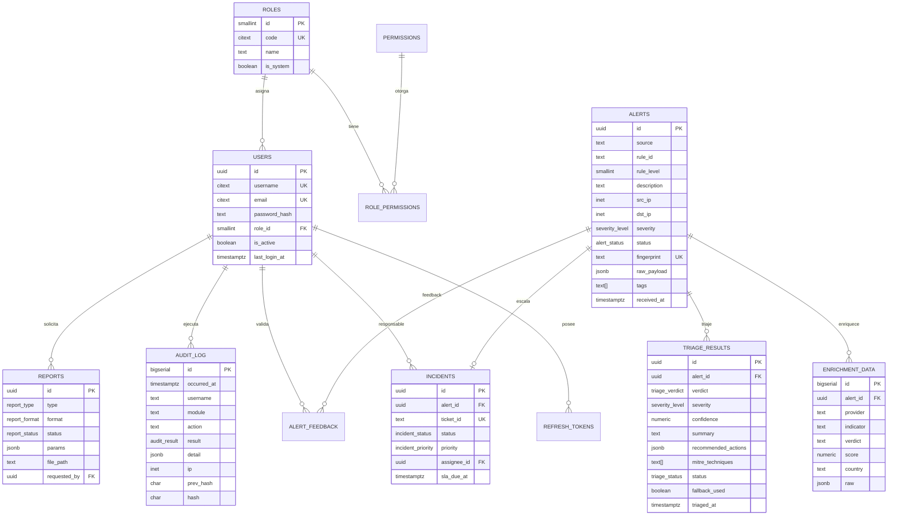

# 2. Modelo de datos PostgreSQL y datos semilla

> Motor: **PostgreSQL 16**. Esquema completo en [`db/schema.sql`](../db/schema.sql); datos de
> demostración en [`db/seed.sql`](../db/seed.sql).

---

## 2.1 Principios de diseño

1. **Lo consultable es relacional; lo heterogéneo es `JSONB`.** IPs en `INET`, fechas en
   `TIMESTAMPTZ`, estados en `ENUM`, técnicas MITRE en `ARRAY`.
2. **El histórico no se sobrescribe.** Cada ejecución de triaje crea una fila nueva; la alerta
   conserva la última como vista materializada lógica (`LATERAL ... ORDER BY triaged_at DESC`).
3. **La auditoría es append-only.** `UPDATE`/`DELETE` bloqueados por trigger y hash encadenado.
4. **Integridad en la base, no sólo en la aplicación.** `CHECK`, `UNIQUE`, `FK` con `ON DELETE`
   explícito y enums nativos.
5. **Consultas del dashboard en SQL.** `percentile_cont`, `FILTER`, `generate_series` y CTEs;
   PostgreSQL calcula, Python sólo serializa.

---

## 2.2 Diagrama entidad-relación



---

## 2.3 Tipos enumerados

| Enum | Valores | Uso |
|---|---|---|
| `severity_level` | `critical`, `high`, `medium`, `low`, `info` | Alertas y triaje |
| `alert_status` | `pending`, `triaging`, `triaged`, `in_review`, `escalated`, `closed`, `false_positive`, `discarded` | Ciclo de vida |
| `triage_verdict` | `true_positive`, `false_positive`, `suspicious`, `benign`, `inconclusive` | Decisión del agente |
| `triage_status` | `pending`, `completed`, `degraded`, `failed` | Calidad de la ejecución |
| `incident_status` | `open`, `investigating`, `contained`, `resolved`, `closed` | Gestión del incidente |
| `incident_priority` | `P1`, `P2`, `P3`, `P4` | Prioridad y SLA |
| `audit_result` | `success`, `failure`, `denied` | Resultado auditado |
| `report_type` | `operational`, `management`, `audit` | Tipo de reporte |
| `report_format` | `pdf`, `docx`, `xlsx` | Formato de salida |
| `report_status` | `queued`, `generating`, `ready`, `failed` | Estado de generación |
| `integration_type` | `siem`, `edr`, `ticketing`, `chat`, `threat_intel`, `llm` | Catálogo de integraciones |

**¿Por qué enums nativos?** Validación en la base, índices compactos y consultas legibles
(`WHERE severity = 'critical'`). El coste es una migración controlada al añadir valores
(`ALTER TYPE ... ADD VALUE`); se documenta en §2.9.

---

## 2.4 Diccionario de tablas

### 2.4.1 `roles`

| Columna | Tipo | Restricciones | Descripción |
|---|---|---|---|
| `id` | `smallserial` | PK | Identificador |
| `code` | `citext` | UNIQUE, NOT NULL | `admin`, `soc_manager`, `analyst`, `auditor`, `viewer` |
| `name` | `text` | NOT NULL | Nombre visible |
| `description` | `text` | — | Propósito del rol |
| `is_system` | `boolean` | NOT NULL, default false | Los roles de sistema no se eliminan |
| `created_at` | `timestamptz` | default `now()` | Alta |

### 2.4.2 `permissions` y `role_permissions`

| Columna | Tipo | Restricciones | Descripción |
|---|---|---|---|
| `id` | `serial` | PK | Identificador |
| `code` | `text` | UNIQUE, NOT NULL | `alerts:read`, `reports:export`… |
| `module` | `text` | NOT NULL | `dashboard`, `alerts`, `triage`, `incidents`, `users`, `roles`, `audit`, `reports` |
| `action` | `text` | NOT NULL | `read`, `create`, `update`, `delete`, `export`, `run`, `feedback`, `close` |
| `description` | `text` | — | Texto para la matriz de la UI |

`role_permissions(role_id, permission_id)` es la tabla puente con PK compuesta y `ON DELETE CASCADE`.

### 2.4.3 `users`

| Columna | Tipo | Restricciones | Descripción |
|---|---|---|---|
| `id` | `uuid` | PK, `gen_random_uuid()` | Identificador |
| `username` | `citext` | UNIQUE, 3–64 | Login insensible a mayúsculas |
| `email` | `citext` | UNIQUE, CHECK regex | Contacto |
| `full_name` | `text` | NOT NULL | Nombre visible |
| `password_hash` | `text` | NOT NULL | bcrypt (coste 12) |
| `role_id` | `smallint` | FK `roles` | Rol único por usuario |
| `is_active` | `boolean` | default true | Acceso habilitado |
| `mfa_enabled` | `boolean` | default false | Reservado para TOTP |
| `last_login_at` | `timestamptz` | — | Último acceso |
| `created_at` / `updated_at` | `timestamptz` | `now()` + trigger | Trazabilidad |
| `deleted_at` | `timestamptz` | — | Baja lógica |

### 2.4.4 `refresh_tokens`

| Columna | Tipo | Restricciones | Descripción |
|---|---|---|---|
| `id` | `uuid` | PK | Identificador |
| `user_id` | `uuid` | FK `users` ON DELETE CASCADE | Titular |
| `token_hash` | `char(64)` | UNIQUE | SHA-256 del token; nunca se guarda en claro |
| `user_agent` / `ip` | `text` / `inet` | — | Contexto de la sesión |
| `expires_at` | `timestamptz` | NOT NULL | Caducidad |
| `revoked_at` | `timestamptz` | — | Rotación / logout |
| `created_at` | `timestamptz` | `now()` | Emisión |

### 2.4.5 `alerts` (tabla central)

| Columna | Tipo | Restricciones | Descripción |
|---|---|---|---|
| `id` | `uuid` | PK | Identificador interno |
| `external_id` | `text` | — | ID en Wazuh/OPNsense |
| `source` | `text` | NOT NULL | `wazuh`, `opnsense`, `suricata`… |
| `rule_id` | `text` | — | Regla del SIEM |
| `rule_level` | `smallint` | CHECK 0–16 | Nivel original |
| `description` | `text` | NOT NULL | Texto de la alerta |
| `src_ip` / `dst_ip` | `inet` | — | Origen/destino |
| `src_port` / `dst_port` | `integer` | CHECK 0–65535 | Puertos |
| `protocol` | `text` | — | tcp/udp/icmp |
| `agent_name` | `text` | — | Activo afectado |
| `asset_criticality` | `smallint` | CHECK 1–5 | Criticidad del activo |
| `severity` | `severity_level` | NOT NULL | Severidad efectiva |
| `status` | `alert_status` | NOT NULL, default `pending` | Ciclo de vida |
| `fingerprint` | `text` | UNIQUE, NOT NULL | SHA-256 de correlación (ventana 15 min) |
| `raw_payload` | `jsonb` | default `{}` | Payload original |
| `tags` | `text[]` | default `{}` | Etiquetas derivadas |
| `dedup_count` | `integer` | default 1 | Repeticiones agregadas |
| `occurred_at` | `timestamptz` | — | Cuándo ocurrió en el SIEM |
| `received_at` | `timestamptz` | default `now()` | Cuándo llegó a SOC-Lite |
| `last_seen_at` | `timestamptz` | default `now()` | Última repetición |
| `created_at` | `timestamptz` | default `now()` | Alta |

**Índices:** `severity`, `status`, `received_at DESC`, `source`, `src_ip`, `agent_name`, `rule_id`,
GIN en `tags`, GIN trigram en `description`, UNIQUE en `fingerprint`.

**Cálculo de la huella** (`services/alert_ingest.py`):

```text
fingerprint = sha256(source | rule_id | src_ip | dst_ip | external_id | floor(occurred_at / 15min))
```

La ventana de 15 minutos agrupa ráfagas del mismo evento sin impedir que el mismo ataque se
registre al día siguiente.

### 2.4.6 `enrichment_data`

| Columna | Tipo | Descripción |
|---|---|---|
| `id` | `bigserial` PK | — |
| `alert_id` | `uuid` FK CASCADE | Alerta enriquecida |
| `provider` | `text` | `virustotal`, `abuseipdb`, `geoip`, `mitre`, `internal` |
| `indicator` | `text` | IP, dominio, hash, URL |
| `indicator_type` | `text` | `ip`, `domain`, `hash`, `url`, `host`, `technique` |
| `verdict` | `text` | `malicious`, `suspicious`, `clean`, `unknown` |
| `score` | `numeric(5,2)` | 0–100 |
| `country` / `asn` | `text` | Geolocalización |
| `raw` | `jsonb` | Respuesta original saneada |
| `fetched_at` / `expires_at` | `timestamptz` | TTL del proveedor |

### 2.4.7 `triage_results`

| Columna | Tipo | Descripción |
|---|---|---|
| `id` | `uuid` PK | — |
| `alert_id` | `uuid` FK CASCADE | Alerta |
| `verdict` | `triage_verdict` | Decisión |
| `severity` | `severity_level` | Severidad sugerida |
| `confidence` | `numeric(4,3)` | 0.000–1.000 |
| `summary` | `text` | Resumen operativo en español |
| `reasoning` | `text` | Justificación |
| `recommended_actions` | `jsonb` | `[{action, priority, owner}]` |
| `mitre_techniques` | `text[]` | `T1110`, `T1486`… |
| `model` | `text` | `llama3.1:8b` o `heuristic-engine` |
| `prompt_version` | `text` | `v1.2.0` |
| `latency_ms` | `integer` | Duración |
| `status` | `triage_status` | `completed` / `degraded` / `failed` |
| `needs_human` | `boolean` | Requiere revisión |
| `fallback_used` | `boolean` | Se usó heurística |
| `raw_response` | `jsonb` | Respuesta del modelo (saneada) |
| `triaged_at` | `timestamptz` | Momento |

**Índices:** `(alert_id, triaged_at DESC)`, `verdict`, `triaged_at DESC`.

### 2.4.8 `alert_feedback`

| Columna | Tipo | Descripción |
|---|---|---|
| `id` | `bigserial` PK | — |
| `alert_id` | `uuid` FK CASCADE | Alerta validada |
| `user_id` | `uuid` FK SET NULL | Analista |
| `is_false_positive` | `boolean` | Decisión humana |
| `comment` | `text` | Justificación |
| `created_at` | `timestamptz` | Fecha/hora |

`UNIQUE(alert_id, user_id)`: una validación por analista y alerta (se actualiza si cambia).

### 2.4.9 `incidents`

| Columna | Tipo | Descripción |
|---|---|---|
| `id` | `uuid` PK | — |
| `alert_id` | `uuid` FK SET NULL | Alerta origen |
| `ticket_id` | `text` UNIQUE | `OSK-000123` u osTicket externo |
| `title` / `description` | `text` | Contenido |
| `status` | `incident_status` | Ciclo de vida |
| `priority` | `incident_priority` | P1–P4 |
| `assignee_id` | `uuid` FK SET NULL | Responsable |
| `sla_due_at` | `timestamptz` | Vencimiento (4/8/24/72 h según prioridad) |
| `opened_at` / `closed_at` | `timestamptz` | Fechas |
| `resolution` | `text` | Cierre |
| `created_at` / `updated_at` | `timestamptz` | Trazabilidad |

### 2.4.10 `audit_log` (append-only)

| Columna | Tipo | Descripción |
|---|---|---|
| `id` | `bigserial` PK | Identificador interno |
| `chain_seq` | `bigint` UNIQUE | Posición en la cadena; la asigna el trigger bajo advisory lock |
| `occurred_at` | `timestamptz` | Fecha y hora del evento |
| `user_id` | `uuid` FK SET NULL | Usuario (si existe) |
| `username` | `text` | Copia desnormalizada para conservar evidencia |
| `module` | `text` | Módulo (`alerts`, `triage`, `auth`…) |
| `action` | `text` | `ENTER`, `EXIT`, `LOGIN`, `ALERT_INGEST`, `TRIAGE_RUN`… |
| `entity_type` / `entity_id` | `text` | Entidad afectada |
| `result` | `audit_result` | `success`, `failure`, `denied` |
| `detail` | `jsonb` | Contexto (cambios, parámetros, motivo) |
| `ip` | `inet` | Origen |
| `user_agent` | `text` | Cliente |
| `request_id` | `text` | Correlación con logs |
| `duration_ms` | `integer` | Duración (EXIT) |
| `prev_hash` | `char(64)` | Hash anterior |
| `hash` | `char(64)` | Hash de esta fila |

**Trigger `fn_audit_chain`:** bajo un advisory lock asigna `chain_seq` con la secuencia
`audit_log_chain_seq_seq` (no usa `id`, porque `bigserial` se asigna antes del trigger y dos
transacciones concurrentes pueden intercalar sus ids), toma el hash previo y concatena
`prev_hash|occurred_at|user_id|username|module|action|entity_id|result|detail` y calcula SHA-256
con `pgcrypto`.

**Trigger `fn_audit_immutable`:** lanza excepción ante `UPDATE` o `DELETE`.

**Limitación honesta:** un superusuario puede deshabilitar triggers; para evidencia legal se
recomienda exportar periódicamente a almacenamiento WORM.

### 2.4.11 `integrations`

Catálogo de conectores: `name`, `type` (`siem`, `edr`, `ticketing`, `chat`, `threat_intel`, `llm`),
`config` JSONB (referencias a variables de entorno, **nunca secretos en claro**), `enabled`,
`last_check_at`.

### 2.4.12 `reports`

| Columna | Tipo | Descripción |
|---|---|---|
| `id` | `uuid` PK | — |
| `type` | `report_type` | operacional / gestión / auditoría |
| `format` | `report_format` | pdf / docx / xlsx |
| `status` | `report_status` | queued / generating / ready / failed |
| `params` | `jsonb` | Periodo, título, solicitante |
| `file_path` / `file_size` | `text` / `bigint` | Archivo generado |
| `requested_by` | `uuid` FK SET NULL | Autor |
| `created_at` / `completed_at` | `timestamptz` | Fechas |
| `error` | `text` | Detalle si falló |

---

## 2.5 Vistas

| Vista | Propósito |
|---|---|
| `v_alert_overview` | Alerta + último triaje + incidente + MTTT en minutos |
| `v_incident_overview` | Incidente + severidad/descripción de la alerta + nombre del responsable |
| `v_dashboard_daily` | Serie diaria de los últimos 30 días por severidad |
| `v_mttt_stats` | Promedio, P95, mínimo y máximo del MTTT por severidad |
| `v_audit_recent` | Últimos 500 eventos con hash corto (para UI) |

Ejemplo de `v_alert_overview`:

```sql
SELECT a.id, a.severity, t.verdict, t.confidence,
       EXTRACT(EPOCH FROM (t.triaged_at - a.received_at)) / 60.0 AS mttt_minutes
FROM alerts a
LEFT JOIN LATERAL (
    SELECT * FROM triage_results tr
    WHERE tr.alert_id = a.id
    ORDER BY tr.triaged_at DESC LIMIT 1
) t ON true;
```

---

## 2.6 Triggers y funciones

| Objeto | Tipo | Función |
|---|---|---|
| `trg_audit_chain` | BEFORE INSERT en `audit_log` | Calcula `prev_hash` y `hash` con advisory lock |
| `trg_audit_no_update` | BEFORE UPDATE/DELETE | Bloquea modificaciones |
| `trg_users_touch` / `trg_incidents_touch` | BEFORE UPDATE | Actualiza `updated_at` |
| `trg_alert_dedup` | BEFORE INSERT | Ajusta `last_seen_at` si es duplicado agregado |
| `generate_synthetic_alerts(count, days)` | Función PL/pgSQL | Genera alertas, triajes, feedback e incidentes realistas |

---

## 2.7 Datos semilla

### Roles y permisos

| Rol | Permisos | Usuarios demo |
|---|---|---|
| `admin` | 26 (todos) | `admin` |
| `soc_manager` | 22 (operación + lectura de usuarios/roles) | `gerente` |
| `analyst` | 13 (alertas, triaje, incidentes, reportes) | `analista1`, `analista2` |
| `auditor` | 10 (lectura + auditoría + reportes) | `auditor` |
| `viewer` | 4 (solo lectura) | `visor` |

### Volumen generado

| Tabla | Filas | Detalle |
|---|---|---|
| `roles` | 5 | Roles de sistema |
| `permissions` | 26 | 8 módulos × acciones |
| `users` | 6 | Contraseñas bcrypt vía `pgcrypto` |
| `alerts` | 728 | 8 curadas + 720 sintéticas en 60 días |
| `triage_results` | 647 | ~89 % de las alertas triadas |
| `incidents` | 33 | Solo alta/crítica |
| `enrichment_data` | 9 | IOC de las alertas curadas |
| `alert_feedback` | ~200 | Validaciones humanas |

La distribución sintética es deliberadamente realista: **> 40 % benigno**, ~12 % falso positivo,
~20 % verdadero positivo y el resto sospechoso/inconcluso. Así el dashboard muestra el problema
que SOC-Lite resuelve (ruido) y no un mundo ideal.

### Alertas curadas (historias de demostración)

| ID corto | Escenario | Severidad | Veredicto | Incidente |
|---|---|---|---|---|
| `...1101` | Fuerza bruta SSH contra SRV-WEB01 | Crítica | Verdadero positivo | OSK-10001 |
| `...1102` | Ransomware en SRV-FILE01 | Crítica | Verdadero positivo | OSK-10002 |
| `...1103` | Escaneo de puertos bloqueado | Baja | Falso positivo | — |
| `...1104` | PowerShell con C2 en WKS-GERENCIA | Alta | Sospechoso | OSK-10003 |
| `...1105` | Login fallido aislado interno | Media | Falso positivo | — |
| `...1106` | Explotación CVE-2024-4577 | Alta | Verdadero positivo | OSK-10004 |
| `...1107` | DNS a dominio recién registrado | Media | Benigno | — |
| `...1108` | Conexión bloqueada por firewall | Info | Benigno | — |

### Generador sintético

```sql
-- 5 000 alertas en 90 días para pruebas de carga
SELECT generate_synthetic_alerts(5000, 90);

-- Verificación
SELECT severity, count(*) FROM alerts GROUP BY 1 ORDER BY 2 DESC;
SELECT * FROM v_mttt_stats;
```

El generador usa `setseed(0.4242)` para reproducibilidad y respeta las FKs (usuarios, roles,
incidentes, feedback).

---

## 2.8 Consultas de referencia

### Último triaje por alerta

```sql
SELECT DISTINCT ON (tr.alert_id) tr.*
FROM triage_results tr
ORDER BY tr.alert_id, tr.triaged_at DESC;
```

### MTTT promedio y P95

```sql
SELECT a.severity,
       ROUND(AVG(EXTRACT(EPOCH FROM (t.triaged_at - a.received_at)) / 60.0)::numeric, 1) AS avg_min,
       ROUND(PERCENTILE_CONT(0.95) WITHIN GROUP (
             ORDER BY EXTRACT(EPOCH FROM (t.triaged_at - a.received_at)) / 60.0)::numeric, 1) AS p95_min
FROM alerts a
JOIN LATERAL (SELECT * FROM triage_results tr WHERE tr.alert_id = a.id
              ORDER BY tr.triaged_at DESC LIMIT 1) t ON true
GROUP BY a.severity;
```

### Cumplimiento de SLA por severidad

```sql
WITH latest AS (
  SELECT DISTINCT ON (alert_id) alert_id, triaged_at
  FROM triage_results ORDER BY alert_id, triaged_at DESC
)
SELECT a.severity,
       COUNT(*) AS total,
       COUNT(*) FILTER (
         WHERE EXTRACT(EPOCH FROM (l.triaged_at - a.received_at)) / 60.0
               <= CASE a.severity WHEN 'critical' THEN 15 WHEN 'high' THEN 30
                                  WHEN 'medium' THEN 240 ELSE 1440 END
       ) AS dentro_sla
FROM alerts a JOIN latest l ON l.alert_id = a.id
GROUP BY a.severity;
```

### Tasa de falsos positivos

```sql
SELECT ROUND(
  100.0 * COUNT(*) FILTER (WHERE t.verdict = 'false_positive') / NULLIF(COUNT(*), 0), 1
) AS fp_rate
FROM triage_results t
JOIN alerts a ON a.id = t.alert_id
WHERE a.received_at >= now() - interval '30 days';
```

### Verificación de la cadena de auditoría

```sql
SELECT id, prev_hash, hash,
       encode(digest(
         COALESCE(prev_hash,'') || '|' || CAST(occurred_at AS text) || '|' ||
         COALESCE(CAST(user_id AS text),'') || '|' || COALESCE(username,'') || '|' ||
         module || '|' || action || '|' || COALESCE(entity_id,'') || '|' ||
         CAST(result AS text) || '|' || COALESCE(CAST(detail AS text),'{}'),
         'sha256'), 'hex') AS esperado
FROM audit_log ORDER BY id;
```

Si `hash <> esperado` o `prev_hash` no coincide con el hash anterior, la cadena está rota.

---

## 2.9 Operación del esquema

### Aplicar desde cero

```bash
psql -h 127.0.0.1 -p 5439 -U soclite -d soclite -f db/schema.sql
psql -h 127.0.0.1 -p 5439 -U soclite -d soclite -f db/seed.sql
```

`schema.sql` es **destructivo en desarrollo**: elimina vistas, tablas y tipos antes de recrearlos.
En producción se debe usar Alembic (recomendado) o migraciones versionadas.

### Añadir un valor a un enum

```sql
ALTER TYPE alert_status ADD VALUE IF NOT EXISTS 'suppressed';
-- No se puede usar el nuevo valor en la misma transacción; commit y luego usarlo.
```

### Particionado de `audit_log` (crecimiento)

```sql
-- Ejemplo conceptual: partición mensual por occurred_at
CREATE TABLE audit_log_2026_10 PARTITION OF audit_log
  FOR VALUES FROM ('2026-10-01') TO ('2026-11-01');
```

Para adoptarlo, `audit_log` debe declararse `PARTITION BY RANGE (occurred_at)` y la PK incluir
`occurred_at`. Se documenta como evolución, no está aplicado en esta versión.

### Respaldos

```bash
pg_dump -Fc -h 127.0.0.1 -p 5439 -U soclite soclite > soclite_$(date +%F).dump
pg_restore -h 127.0.0.1 -p 5439 -U soclite -d soclite --clean --if-exists soclite_2026-10-20.dump
```

Frecuencia recomendada: diaria completa + WAL continuo; retención 30 días; prueba de restauración
mensual.

---

## 2.10 Decisiones y límites

| Decisión | Motivo | Límite |
|---|---|---|
| Un rol por usuario | Simplicidad operativa para PYME | Un usuario con necesidades mixtas requiere rol a medida |
| `JSONB` para el payload | Heterogeneidad de SIEM | Consultas analíticas sobre el crudo son más costosas |
| Enums nativos | Integridad y rendimiento | Añadir valores requiere migración |
| Baja lógica de usuarios | Preservar auditoría e historial | Hay que filtrar `deleted_at IS NULL` en todas las consultas |
| Hash chain en trigger | Integridad incluso fuera de la app | Serializa inserts de auditoría (advisory lock) |
| Sin particionado inicial | Simplicidad de despliegue | A gran volumen (> 10 M eventos) hay que particionar |
