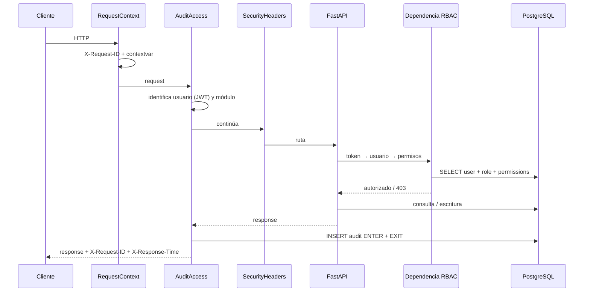
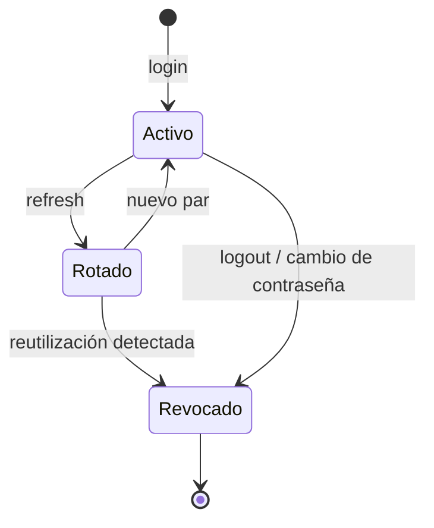

# 3. Desarrollo del backend

> **Stack:** Python 3.11 · FastAPI 0.115 · SQLAlchemy 2.0 async · asyncpg · Pydantic v2 ·
> PostgreSQL 16 · ReportLab · python-docx · openpyxl.
> Código en [`backend/`](../backend); pruebas en [`backend/tests/`](../backend/tests).

---

## 3.1 Estructura

```text
backend/
├── app/
│   ├── main.py                    # create_app, middlewares, routers, lifespan
│   ├── core/
│   │   ├── config.py              # Settings (pydantic-settings, 12-factor)
│   │   ├── security.py            # bcrypt, JWT, refresh, política de contraseñas
│   │   ├── deps.py                # get_current_user, require_permission, paginación, IP
│   │   ├── permissions.py         # catálogo P() de 26 permisos
│   │   ├── errors.py              # AppError y handlers uniformes
│   │   └── logging.py             # JSON logs + request_id/username contextvars
│   ├── db/
│   │   ├── base.py                # DeclarativeBase + naming convention
│   │   └── session.py             # engine async, SessionLocal, get_db
│   ├── models/                    # security, alert, incident, audit + enums
│   ├── schemas/                   # common, auth, user, alert, dashboard, report
│   ├── api/v1/
│   │   ├── router.py              # agregador /api/v1
│   │   └── routers/               # auth, users, alerts, incidents, dashboard,
│   │                              # reports, audit, health
│   ├── services/
│   │   ├── alert_ingest.py        # normalización Wazuh/OPNsense + fingerprint
│   │   ├── triage_client.py       # cliente LangChain + fallback heurístico
│   │   ├── dashboard.py           # agregaciones SQL (MTTT, SLA, FP, top)
│   │   ├── reports.py             # PDF, DOCX, XLSX
│   │   └── audit.py               # record(), verify_chain()
│   └── middleware/
│       └── audit_middleware.py    # request-id, cabeceras, ENTER/EXIT
├── tests/                         # 14 pruebas de integración
├── requirements.txt
├── pytest.ini
└── Dockerfile
```

**Patrón:** routers delgados (validación + autorización + respuesta) y **servicios** con la lógica
reutilizable. Los modelos nunca se serializan directamente: se usan esquemas Pydantic.

---

## 3.2 Configuración

`app/core/config.py` usa `pydantic-settings` con `.env`. Las variables principales:

| Variable | Default | Descripción |
|---|---|---|
| `SECRET_KEY` | (dev) | Firma JWT; **obligatoria en producción** |
| `ACCESS_TOKEN_EXPIRE_MINUTES` | 30 | Vida del access token |
| `REFRESH_TOKEN_EXPIRE_DAYS` | 7 | Vida del refresh token |
| `PASSWORD_MIN_LENGTH` | 10 | Política de contraseña |
| `DATABASE_URL` | `postgresql+asyncpg://...:5439/soclite` | Conexión |
| `INGEST_API_KEY` | `dev-ingest-key-change-me` | Clave del webhook |
| `TRIAGE_SERVICE_URL` | `http://127.0.0.1:8011` | Microservicio LangChain |
| `TRIAGE_TIMEOUT_SECONDS` | 25 | Timeout del triaje |
| `TRIAGE_FAIL_OPEN` | true | Usar heurística si el LLM falla |
| `DEDUP_WINDOW_MINUTES` | 15 | Ventana de correlación |
| `SLA_CRITICAL/HIGH/MEDIUM/LOW` | 15/30/240/1440 | Objetivos en minutos |
| `CORS_ORIGINS` | localhost:8090 | Orígenes permitidos |
| `REPORTS_DIR` | `storage/reports` | Salida de reportes |

En `lifespan` se rechaza el arranque en producción si `SECRET_KEY` conserva el valor de desarrollo.
`/health` devuelve estado de BD; `/health/ready` añade el estado del microservicio de triaje.

---

## 3.3 Ciclo de vida de un request



Orden real de middlewares (Starlette ejecuta el último añadido primero):
`RequestContext → AuditAccess → SecurityHeaders → CORS → router`.

**Detalle importante:** la bitácora ENTER/EXIT se escribe **después** de la respuesta, con
`occurred_at` del inicio y `duration_ms` medido. Así no se penaliza la latencia del endpoint, pero
se conserva el instante de entrada. Si la escritura de auditoría falla, en desarrollo se registra
el error sin romper la respuesta; en producción se propaga (fail-closed de evidencia).

---

## 3.4 Autenticación y sesión

### Login

```http
POST /api/v1/auth/login
Content-Type: application/json

{"username": "analista1", "password": "Analista123!"}
```

```json
{
  "access_token": "eyJhbGciOiJIUzI1NiIs...",
  "refresh_token": "eyJhbGciOiJIUzI1NiIs...",
  "token_type": "bearer",
  "expires_in": 1800,
  "user": {
    "id": "…",
    "username": "analista1",
    "role": {"id": 3, "code": "analyst", "name": "Analista SOC"},
    "permissions": ["alerts:read", "triage:run", "…"]
  }
}
```

**Claims del access token:**

```json
{
  "sub": "uuid-del-usuario",
  "type": "access",
  "username": "analista1",
  "role": "analyst",
  "permissions": ["alerts:read", "…"],
  "iat": 1792491284,
  "nbf": 1792491284,
  "exp": 1792493084,
  "jti": "…",
  "iss": "soc-lite"
}
```

### Refresh con rotación

1. El cliente envía `POST /auth/refresh` con el refresh token.
2. El backend verifica firma, tipo, caducidad y que el **hash SHA-256** exista y no esté revocado.
3. Si el token ya fue rotado (`revoked_at != null`), se **revocan todas las sesiones** del usuario y
   se audita `TOKEN_REUSE_DETECTED` con resultado `denied`.
4. Si es válido, se revoca el anterior y se emite un par nuevo.



### Contraseñas

- Hash **bcrypt coste 12** (`bcrypt.hashpw`), comparación con `checkpw`.
- Política: mínimo 10 caracteres, mayúscula, minúscula, dígito y símbolo; se valida también en
  creación y reseteo.
- `POST /auth/change-password` exige la contraseña actual, invalida todos los refresh tokens y
  audita el cambio.
- El administrador puede resetear con `POST /users/{id}/reset-password` (auditado, revoca sesiones).

### Logout

`POST /auth/logout` revoca todos los refresh tokens del usuario (o sólo el enviado) y audita
`LOGOUT`. El access token sigue siendo válido hasta su expiración (30 min); para revocación
inmediata se necesitaría una lista de denegación, documentada como evolución.

---

## 3.5 RBAC

### Catálogo de permisos (26)

| Módulo | Permisos |
|---|---|
| `dashboard` | `read`, `export` |
| `alerts` | `read`, `create`, `update`, `delete`, `export` |
| `triage` | `read`, `run`, `feedback` |
| `incidents` | `read`, `create`, `update`, `close`, `export` |
| `users` | `read`, `create`, `update`, `delete` |
| `roles` | `read`, `update` |
| `audit` | `read`, `export` |
| `reports` | `read`, `create`, `export` |

### Matriz rol ↔ permiso

| Permiso | admin | soc_manager | analyst | auditor | viewer |
|---|:---:|:---:|:---:|:---:|:---:|
| `dashboard:read` | ✓ | ✓ | ✓ | ✓ | ✓ |
| `dashboard:export` | ✓ | ✓ | — | — | — |
| `alerts:read` | ✓ | ✓ | ✓ | ✓ | ✓ |
| `alerts:create` | ✓ | ✓ | ✓ | — | — |
| `alerts:update` | ✓ | ✓ | ✓ | — | — |
| `alerts:delete` | ✓ | ✓ | — | — | — |
| `alerts:export` | ✓ | ✓ | ✓ | ✓ | — |
| `triage:read` | ✓ | ✓ | ✓ | ✓ | — |
| `triage:run` | ✓ | ✓ | ✓ | — | — |
| `triage:feedback` | ✓ | ✓ | ✓ | — | — |
| `incidents:read` | ✓ | ✓ | ✓ | ✓ | ✓ |
| `incidents:create` | ✓ | ✓ | ✓ | — | — |
| `incidents:update` | ✓ | ✓ | ✓ | — | — |
| `incidents:close` | ✓ | ✓ | — | — | — |
| `incidents:export` | ✓ | ✓ | — | — | — |
| `users:read` | ✓ | ✓ | — | — | — |
| `users:create` | ✓ | — | — | — | — |
| `users:update` | ✓ | — | — | — | — |
| `users:delete` | ✓ | — | — | — | — |
| `roles:read` | ✓ | ✓ | — | — | — |
| `roles:update` | ✓ | — | — | — | — |
| `audit:read` | ✓ | ✓ | — | ✓ | — |
| `audit:export` | ✓ | ✓ | — | ✓ | — |
| `reports:read` | ✓ | ✓ | ✓ | ✓ | ✓ |
| `reports:create` | ✓ | ✓ | ✓ | ✓ | — |
| `reports:export` | ✓ | ✓ | — | ✓ | — |

El rol `admin` es **inmutable** desde la API para evitar el bloqueo del sistema; los demás roles se
editan en caliente desde la pantalla de roles.

### Implementación

```python
# core/deps.py
def require_permission(*codes: str):
    async def checker(user: CurrentUser) -> User:
        if not any(user.has_permission(code) for code in codes):
            raise Forbidden(f"Se requiere uno de los permisos: {', '.join(codes)}")
        return user
    return checker

# routers/alerts.py
ReadAlerts = Annotated[User, Depends(require_permission(P.ALERTS_READ))]
```

El JWT incluye permisos para pintar el menú, pero `get_current_user` **relee rol y permisos de la
base** en cada request. Un cambio de rol surte efecto en la siguiente petición, sin esperar a que
expire el token.

### Reglas de negocio asociadas

- No puede desactivarse a sí mismo.
- No puede eliminarse al último administrador activo.
- No puede retirar `roles:update` de su propio rol.
- El reset de contraseña revoca sesiones.
- Toda modificación de usuario/rol se audita con `detail.changes`.

---

## 3.6 Bitácora de auditoría

### Doble registro

1. **Acceso (middleware):** para cada request a `/api/v1`, dos filas:
   - `action=ENTER`: método, ruta, query, usuario, IP, request-id, timestamp de inicio.
   - `action=EXIT`: status code, duración, mismo request-id.
2. **Negocio (servicios/routers):** eventos explícitos con contexto:
   `LOGIN`, `LOGIN_FAILED`, `TOKEN_REUSE_DETECTED`, `LOGOUT`, `PASSWORD_CHANGE`,
   `ALERT_INGEST`, `ALERT_DEDUP`, `ALERT_UPDATE`, `TRIAGE_RUN`, `TRIAGE_FEEDBACK`,
   `INCIDENT_CREATE`, `INCIDENT_UPDATE`, `USER_CREATE`, `USER_UPDATE`, `USER_DELETE`,
   `PASSWORD_RESET`, `ROLE_PERMISSIONS_UPDATE`, `REPORT_GENERATE`, `REPORT_DOWNLOAD`,
   `AUDIT_EXPORT`.

Ejemplo de fila:

```json
{
  "id": 142,
  "occurred_at": "2026-10-20T10:15:51.792Z",
  "username": "analista1",
  "module": "triage",
  "action": "TRIAGE_RUN",
  "entity_type": "alert",
  "entity_id": "d6d37274-…",
  "result": "success",
  "detail": {
    "verdict": "true_positive",
    "severity": "critical",
    "confidence": 0.92,
    "model": "llama3.1:8b",
    "fallback": false,
    "latency_ms": 14300
  },
  "ip": "10.10.1.30",
  "request_id": "46e1717c0e75466a81b5b0dec55780e4",
  "duration_ms": 14380,
  "hash": "dd71ef9a68d61a66…"
}
```

### Inmutabilidad y cadena

- `trg_audit_no_update` bloquea `UPDATE`/`DELETE`.
- `trg_audit_chain` asigna `chain_seq` y calcula `prev_hash`/`hash` en cada INSERT bajo
  `pg_advisory_xact_lock`. La cadena se ordena por `chain_seq`, no por `id`, para que dos
  transacciones concurrentes no la rompan.
- `GET /audit/verify-chain` recalcula **en PostgreSQL** con la misma expresión del trigger y compara
  también el eslabón anterior. Devuelve `{valid, checked, broken_at}`.
- Exportación CSV/XLSX (`/audit/export`) también se audita.

**Qué NO hace:** no firma digitalmente, no envía a WORM y no protege contra un superusuario que
desactive triggers. Se recomienda exportación periódica y permisos mínimos.

---

## 3.7 Ingesta y normalización

`POST /api/v1/alerts/ingest` acepta el JSON crudo de Wazuh/OPNsense/Suricata y lo normaliza.

| Campo destino | Fuente Wazuh | Fallback |
|---|---|---|
| `external_id` | `id` | `alert_id`, `event_id` |
| `rule_id` | `rule.id` | `rule_id`, `signature_id` |
| `rule_level` | `rule.level` | `rule_level`, `level` |
| `description` | `rule.description` | `message`, `full_log` |
| `src_ip` | `data.srcip` | `src_ip`, `source_ip` |
| `dst_ip` | `data.dstip` | `dst_ip`, `dest_ip` |
| `dst_port` | `data.dstport` | `dst_port` |
| `agent_name` | `agent.name` | `agent_name`, `host` |
| `asset_criticality` | `asset_criticality` | `agent.criticality`, default 3 |
| `severity` | `severity` explícita | `Severity.from_rule_level()` |
| `tags` | — | regex sobre descripción (`bruteforce`, `ransomware`, `recon`…) |

**Mapeo de severidad:** `level >= 12 → critical`, `>= 10 → high`, `>= 7 → medium`, `>= 4 → low`,
resto `info`. Una severidad explícita en el payload tiene prioridad.

**Deduplicación:** si el `fingerprint` ya existe, incrementa `dedup_count`, actualiza
`last_seen_at` y devuelve `status=duplicate`. El índice UNIQUE garantiza atomicidad incluso con
dos webhooks concurrentes.

**Respuesta:**

```json
{"status": "accepted", "alert_id": "…", "severity": "critical", "deduplicated": false,
 "message": "Alerta registrada en estado pendiente"}
```

Códigos: `202` aceptada o duplicada; `401` clave inválida; `422` payload inválido.

---

## 3.8 Triaje

`POST /api/v1/alerts/{id}/triage` (permiso `triage:run`):

1. Carga la alerta con enriquecimientos e historial.
2. Si existe un triaje de los últimos 60 s y `force=false`, lo devuelve (idempotencia).
3. Marca `triaging` y llama al microservicio LangChain (`POST /triage`, timeout 25 s).
4. Valida la respuesta con `RemoteTriage` (Pydantic).
5. Persiste `triage_results`, guarda enriquecimientos nuevos y actualiza la alerta:
   - `false_positive → status=false_positive`
   - `true_positive` con severidad alta/crítica → `escalated`
   - resto → `triaged`
   - la severidad de la alerta **nunca baja** automáticamente; sólo sube.
6. Audita `TRIAGE_RUN` con veredicto, modelo, latencia y si usó fallback.

**Fallback local** (`services/triage_client.py`): si el servicio no responde, timeout, JSON inválido
o error 5xx, calcula un score con nivel de regla (55 %), criticidad (25 %) e indicadores maliciosos
(20 %), marca `status=degraded` y `fallback_used=true`. Si `TRIAGE_FAIL_OPEN=false`, devuelve 503.

---

## 3.9 Incidentes

- `POST /alerts/{id}/incident`: crea ticket local `OSK-######`, prioridad derivada de la severidad
  (P1 crítica, P2 alta, P3 media, P4 baja), SLA 4/8/24/72 h y asigna al actor si no se indica otro.
- `GET /incidents`: filtros por estado, prioridad, responsable y texto; paginación.
- `PATCH /incidents/{id}`: estado, prioridad, responsable y resolución. Cerrar/resolver exige
  `incidents:close`; asigna `closed_at` automáticamente.
- La integración real con osTicket/Redmine la ejecuta n8n; el backend mantiene el registro local y
  el `ticket_id` para correlación.

---

## 3.10 Dashboard

Todas las métricas se calculan en PostgreSQL con ventanas parametrizadas (`make_interval`) y
`LATERAL` para el último triaje.

| Endpoint | Cálculo |
|---|---|
| `/summary` | Totales por severidad/estado, automatización, FP, SLA, MTTT y deltas vs. periodo anterior |
| `/trend` | `generate_series` diaria + conteos por severidad y FP |
| `/severity` | Distribución con denominador total |
| `/top-sources` | `GROUP BY` IP/agente/regla, orden descendente, límite |
| `/mttt` | `AVG` y `PERCENTILE_CONT(0.95)` por severidad + cumplimiento |
| `/fp-rate` | Serie diaria de triajes y FP |
| `/sla` | Objetivo por severidad y brechas |
| `/analysts` | Acciones auditadas y triajes por usuario |

**Definiciones:**

- **MTTT:** `triaged_at - received_at` en minutos, usando el **último** triaje de cada alerta.
- **Automatización:** alertas con al menos un triaje / total.
- **Tasa FP:** veredicto `false_positive` / alertas triadas.
- **SLA:** porcentaje de triajes dentro del objetivo de su severidad.
- **Deltas:** periodo actual vs. periodo anterior de igual longitud.

---

## 3.11 Reportes

`POST /api/v1/reports` con `{type, format, date_from, date_to}`. El backend:

1. Crea la fila `reports` en estado `generating` y confirma (para tener ID).
2. Recolecta datos con las mismas funciones del dashboard + incidentes + alertas críticas +
   evolución mensual; para auditoría, agrega la bitácora y el resumen por módulo.
3. Renderiza en un hilo (`asyncio.to_thread`) para no bloquear el event loop:
   - **PDF:** ReportLab, A4, portada, KPIs, tabla de severidad con gráfico de barras, MTTT/SLA,
     top orígenes, alertas críticas, incidentes, evolución mensual y anexo de auditoría.
   - **DOCX:** python-docx con encabezados, tablas y metadatos.
   - **XLSX:** openpyxl con 8–10 hojas, estilos, autofiltro, panel congelado y gráficos nativos
     (línea de tendencia y barras de severidad).
4. Guarda en `storage/reports/{uuid}.{ext}`, actualiza estado, tamaño y `completed_at`.
5. Audita `REPORT_GENERATE`. La descarga audita `REPORT_DOWNLOAD` y valida que la ruta esté dentro
   del directorio permitido (anti path traversal).

**Historial:** `GET /reports` paginado; **descarga:** `GET /reports/{id}/download` con
`Content-Disposition` y MIME correcto.

---

## 3.12 Contrato de errores

```json
{
  "detail": "Se requiere uno de los permisos: users:read",
  "code": "FORBIDDEN",
  "request_id": "a0989711a417444a951e9e3377ef1731",
  "path": "/api/v1/users"
}
```

| HTTP | `code` | Cuándo |
|---|---|---|
| 400 | `WEAK_PASSWORD`, `UNKNOWN_PERMISSION` | Validación de negocio |
| 401 | `UNAUTHORIZED` | Token ausente/expirado, credenciales inválidas |
| 403 | `FORBIDDEN` | Permiso insuficiente |
| 404 | `NOT_FOUND` | Recurso inexistente |
| 409 | `CONFLICT` | Duplicado, última cuenta admin, incidente ya existente |
| 422 | `VALIDATION_ERROR` | Payload inválido (incluye `errors[]`) |
| 500 | `REPORT_FAILED` | Fallo de generación |
| 503 | `DB_UNAVAILABLE`, `TRIAGE_UNAVAILABLE` | Dependencia caída |

Los handlers globales capturan `IntegrityError` (409) y `SQLAlchemyError` (503), registran el
`request_id` y nunca exponen el stack al cliente.

---

## 3.13 Pruebas

```bash
cd backend
.venv/bin/python -m pytest -q
# 14 passed in ~4 s
```

| Archivo | Cobertura |
|---|---|
| `test_auth.py` | Login OK/fallido, perfil, RBAC, refresh con rotación y detección de reutilización |
| `test_alerts.py` | Ingesta sin clave, dedup, detalle, triaje con fallback, feedback, incidente, filtros |
| `test_dashboard_reports.py` | Summary y series, reporte XLSX + descarga, cadena de auditoría, evento n8n |

Las pruebas usan **PostgreSQL real** (no mocks) y una fixture que dispone el pool asyncpg entre
event loops. La base debe estar sembrada; los tests crean alertas con UUID para no colisionar.

**Cobertura pendiente (honesta):** no hay pruebas unitarias del render PDF/DOCX (sólo XLSX), ni
pruebas de carga, ni E2E de navegador automatizadas. Se documentan como siguiente paso.

---

## 3.14 Rendimiento y concurrencia

| Tema | Decisión |
|---|---|
| Pool | `pool_size=10`, `max_overflow=20`, `pool_pre_ping`, reciclado 30 min |
| Consultas | Índices por severidad/estado/fecha; `LATERAL` para el último triaje; agregaciones en SQL |
| Paginación | `LIMIT/OFFSET`; para > 100 k filas se recomienda keyset (`received_at, id`) |
| Reportes | `asyncio.to_thread` evita bloquear el event loop |
| Auditoría | Advisory lock serializa la cadena; es el principal coste de escritura |
| Escalado | API sin estado → N réplicas detrás de Nginx; migrar reportes a cola (Celery/RQ) si crece |

**Cuello de botella esperado:** el LLM (5–25 s por alerta). Estrategias: cachear veredictos por
fingerprint, triar en paralelo con concurrencia limitada, usar un modelo 8B cuantizado y reservar
el modelo grande para alta/crítica.

---

## 3.15 Cómo extender

Para añadir un módulo (p. ej. vulnerabilidades):

1. Crear tablas en `db/schema.sql` + enums y vista.
2. Añadir modelo en `app/models/`, esquema en `app/schemas/`.
3. Crear router en `app/api/v1/routers/` y registrarlo en `router.py`.
4. Añadir permisos `vulnerabilities:*` en el catálogo y en `seed.sql`.
5. Añadir navegación y página en el frontend.
6. Añadir pruebas de integración.
7. Documentar el nuevo módulo y su mapeo normativo.

El sistema de auditoría, RBAC, reportes y dashboard son reutilizables sin cambios.
