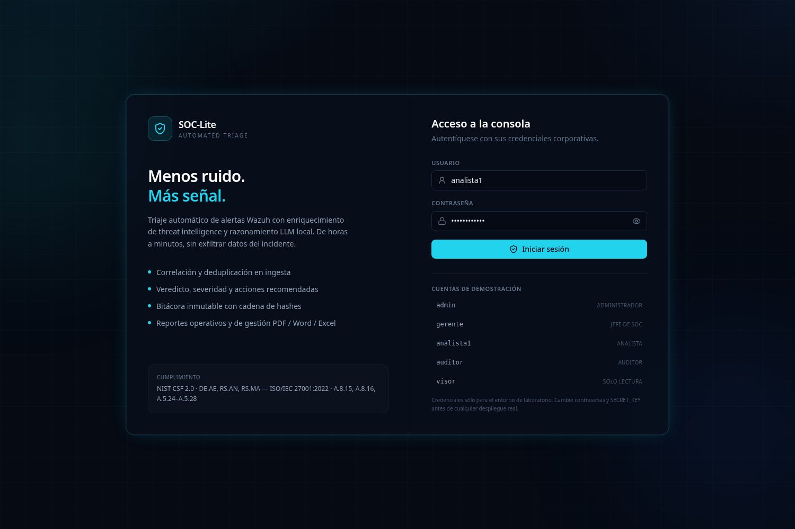
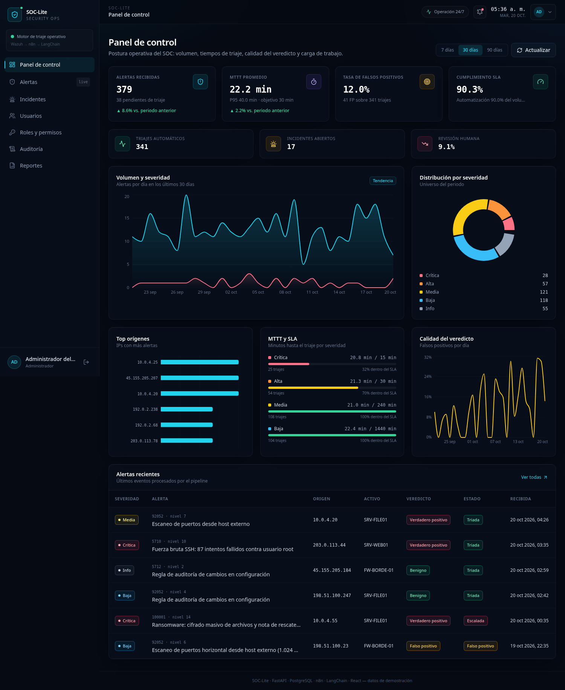
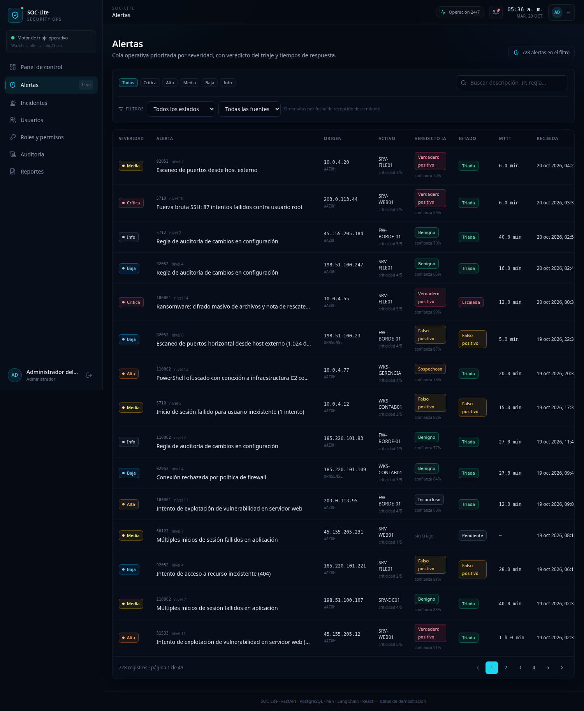
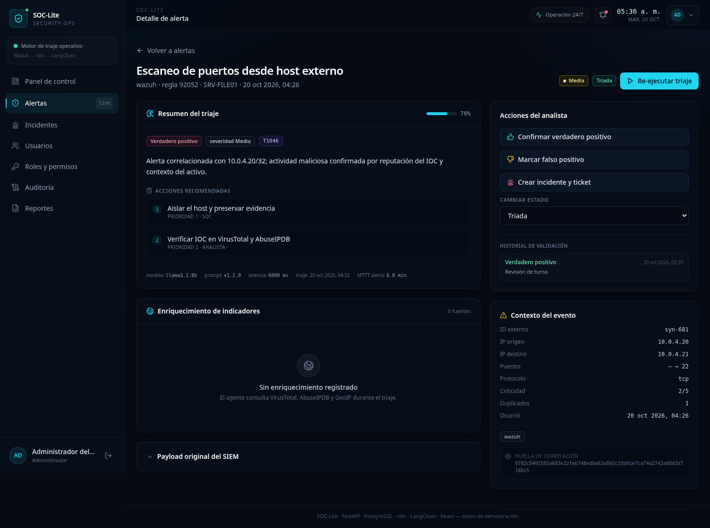
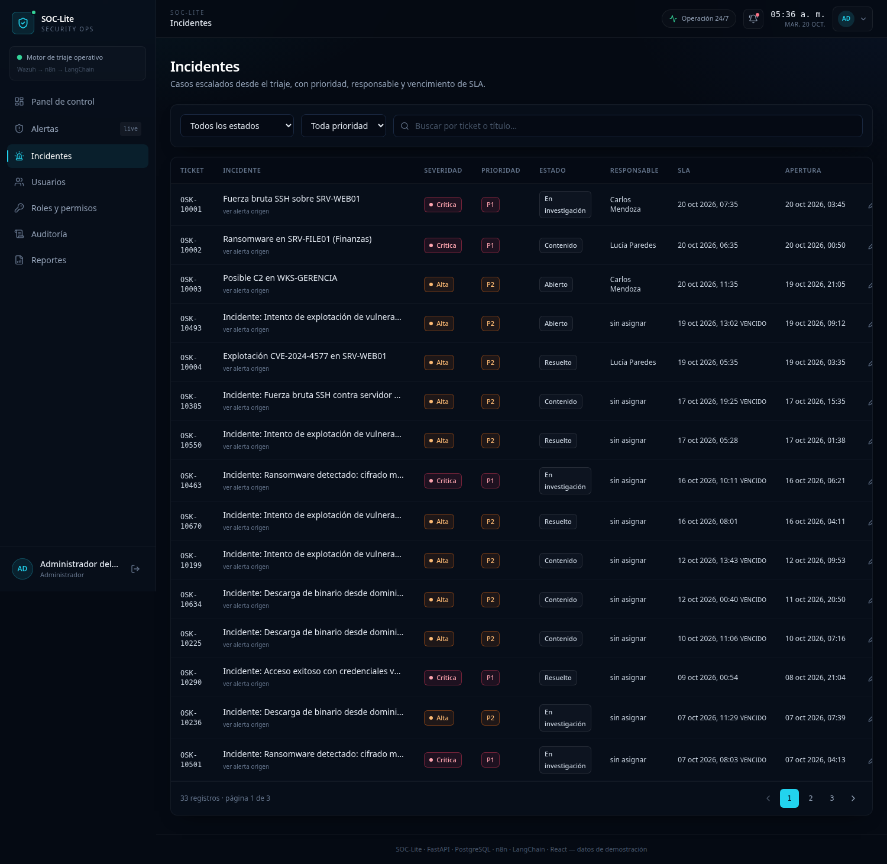
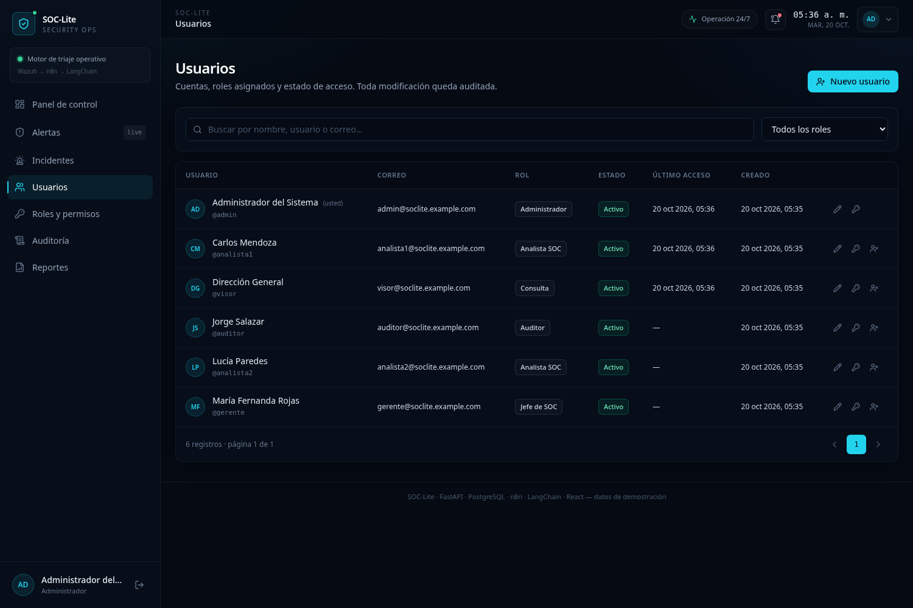
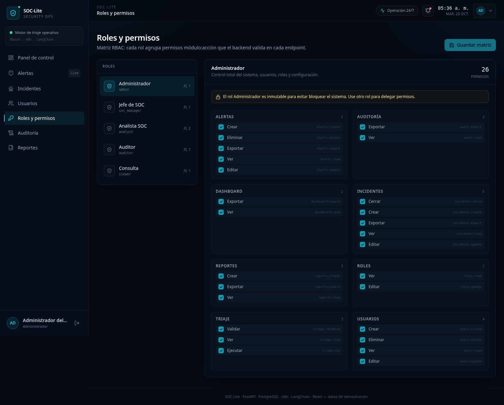
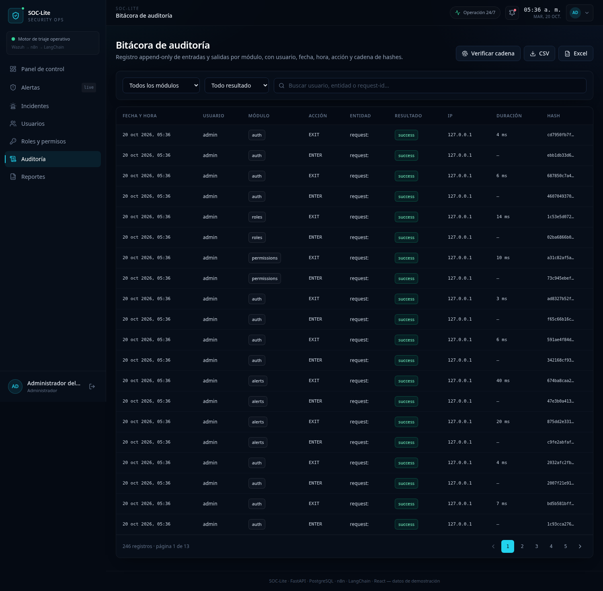
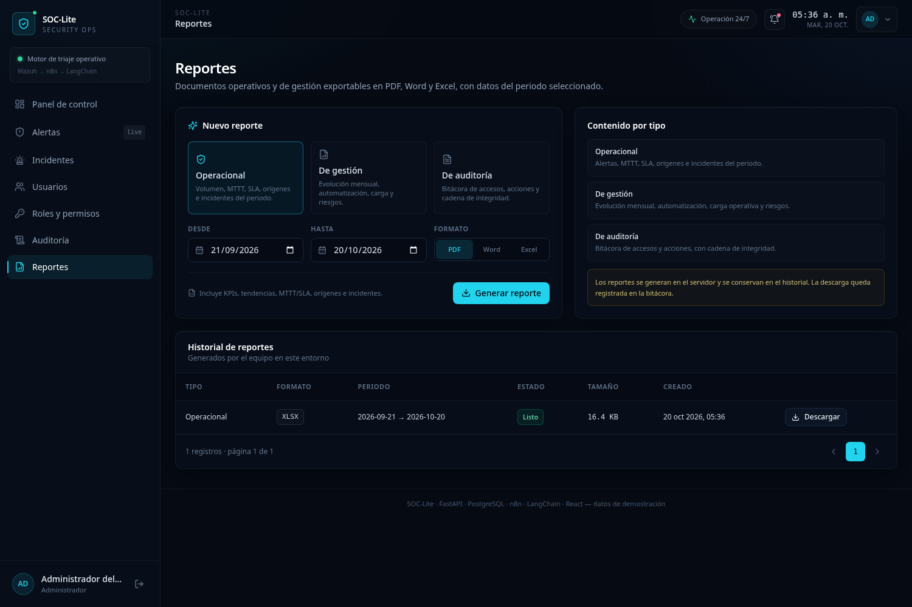

# 4. Desarrollo del frontend

> **Stack:** React 18.3 · TypeScript 5.6 (strict) · Vite 5.4 · Tailwind CSS 3.4 ·
> TanStack Query 5 · React Router 6 · Recharts 2 · Axios · lucide-react · date-fns.
> Código en [`frontend/`](../frontend).

---

## 4.1 Objetivo de la interfaz

La consola está diseñada para un analista que trabaja 8 horas mirando alertas. Por eso:

- **Jerarquía visual por severidad**: el color no es decorativo, es el primer canal de priorización
  (rojo crítico, naranja alto, amarillo medio, azul bajo, gris info).
- **Densidad controlada**: tablas compactas, tipografía monoespaciada para IPs/IDs, pero con aire
  suficiente para escanear.
- **Contexto antes que acción**: el detalle muestra el resumen del LLM, la evidencia y las acciones
  recomendadas antes del botón de validar.
- **Modo claro y oscuro**: el modo claro es el predeterminado. El selector del login y de la
  cabecera guarda la preferencia en `localStorage` (`soclite.theme.v1`) y la sincroniza entre pestañas.
- **Tipografía y geometría**: Adwaita Sans para la interfaz y Adwaita Mono para IPs e identificadores,
  servidas localmente desde `public/fonts/`, con licencia SIL OFL incluida. Controles, tarjetas,
  tablas y barras usan bordes rectos.
- **Estado siempre visible**: badges de estado, banner de cadena de auditoría, indicadores de
  "degradado" cuando el LLM no está disponible.

---

## 4.2 Estructura

```text
frontend/
├── index.html
├── public/
│   ├── theme-init.js           # aplica el tema guardado antes de pintar la interfaz
│   └── fonts/                 # Adwaita Sans, Adwaita Mono y licencia OFL
├── vite.config.ts              # proxy /api → :8010, chunking manual
├── tailwind.config.js          # paleta base/accent/severity, animaciones
├── tsconfig.json               # strict, noUnusedLocals, noUnusedParameters
├── src/
│   ├── main.tsx                # Theme + QueryClient + Router + Auth + Toast
│   ├── App.tsx                 # rutas protegidas y por permiso
│   ├── index.css               # base, componentes (.card, .btn, .table…)
│   ├── api/
│   │   ├── client.ts           # axios, JWT, refresh automático, errores, descargas
│   │   └── index.ts            # endpoints tipados por módulo
│   ├── context/
│   │   ├── ThemeContext.tsx    # modo claro/oscuro persistente
│   │   ├── AuthContext.tsx     # sesión, login/logout, permisos
│   │   └── ToastContext.tsx    # notificaciones efímeras
│   ├── components/
│   │   ├── ThemeToggle.tsx     # selector de tema en login y cabecera
│   │   ├── Layout.tsx          # sidebar, topbar, drawer móvil, reloj, menú de usuario
│   │   ├── RouteGuards.tsx     # ProtectedRoute, PermissionGate, AccessDenied
│   │   ├── Badges.tsx          # severidad, estado, veredicto, prioridad, confianza
│   │   └── ui.tsx              # PageHeader, KpiCard, Spinner, EmptyState,
│   │                           # Pagination, Modal, ErrorBanner
│   ├── pages/
│   │   ├── Login.tsx
│   │   ├── Dashboard.tsx
│   │   ├── Alerts.tsx
│   │   ├── AlertDetail.tsx
│   │   ├── Incidents.tsx
│   │   ├── Users.tsx
│   │   ├── Roles.tsx
│   │   ├── Audit.tsx
│   │   └── Reports.tsx
│   ├── lib/format.ts           # etiquetas, colores, fechas, duraciones, bytes
│   └── types/index.ts          # contrato TypeScript de la API
├── deploy/nginx.conf           # SPA + proxy + CSP
└── Dockerfile                  # build multi-stage + Nginx
```

---

## 4.3 Rutas y control de acceso

| Ruta | Página | Permiso | Guard |
|---|---|---|---|
| `/login` | Login | — | Redirige a `/` si ya hay sesión |
| `/` | Dashboard | `dashboard:read` | `ProtectedRoute` + `PermissionGate` |
| `/alerts` | Cola de alertas | `alerts:read` | idem |
| `/alerts/:id` | Detalle | `alerts:read` | idem |
| `/incidents` | Incidentes | `incidents:read` | idem |
| `/users` | Usuarios | `users:read` | idem |
| `/roles` | Matriz RBAC | `roles:read` | idem |
| `/audit` | Bitácora | `audit:read` | idem |
| `/reports` | Reportes | `reports:read` | idem |
| `*` | 404 | — | — |

```tsx
// components/RouteGuards.tsx
export function ProtectedRoute({ children }: { children: ReactNode }) {
  const { user, loading } = useAuth()
  const location = useLocation()
  if (loading) return <Spinner label="Validando sesión…" />
  if (!user) return <Navigate to="/login" replace state={{ from: location.pathname }} />
  return <>{children}</>
}

export function PermissionGate({ permission, children, fallback = null }) {
  const { hasPermission } = useAuth()
  return hasPermission(permission) ? <>{children}</> : <>{fallback}</>
}
```

La UI **oculta** lo que el rol no puede hacer, pero la decisión real está en el backend. Si un
usuario fuerza la ruta, ve `AccessDenied` y el intento queda en la bitácora.

---

## 4.4 Sesión y cliente HTTP

### Login

1. `POST /auth/login` → `{access_token, refresh_token, user}`.
2. Se guardan los tokens en `localStorage` (`soclite.access_token`, `soclite.refresh_token`).
3. `AuthProvider` carga `GET /auth/me` al montar para validar la sesión y refrescar permisos.

### Refresh transparente

```ts
api.interceptors.response.use(
  (response) => response,
  async (error: AxiosError) => {
    const config = error.config as RetryableConfig | undefined
    if (error.response?.status === 401 && config && !config._retry && !config.url?.includes('/auth/')) {
      config._retry = true
      refreshPromise = refreshPromise ?? refreshAccessToken()
      const token = await refreshPromise
      refreshPromise = null
      if (token) {
        config.headers = { ...config.headers, Authorization: `Bearer ${token}` }
        return api.request(config)
      }
    }
    return Promise.reject(error)
  },
)
```

- Si el refresh falla, se limpia el almacenamiento, se emite `soclite:logout` y el `AuthProvider`
  redirige al login.
- Se comparte una única promesa de refresh para evitar tormentas de 401 con varias queries
  concurrentes.
- Errores homogéneos con `apiErrorMessage()`: usa `detail` del backend, errores de validación o
  mensajes de red/TimeOut.

### Descargas

`downloadBlob()` crea un object URL, dispara un `<a download>` y libera el recurso. Se usa para
reportes y exportación de auditoría.

---

## 4.5 Datos y estado

**TanStack Query** maneja el estado remoto; no hay Redux ni stores globales innecesarios.

| Query key | Contenido | Invalidación |
|---|---|---|
| `['dashboard', days, …]` | summary, trend, severity, sources, mttt, fp | tras triaje, feedback, incidente |
| `['alerts', filters]` | página/filtros de alertas | tras mutaciones de alerta |
| `['alert', id]` | detalle completo | tras triaje/feedback/estado/incidente |
| `['incidents', filters]` | lista de incidentes | tras actualizar incidente |
| `['users', filters]`, `['roles']`, `['permissions']` | administración | tras crear/editar/desactivar |
| `['audit', filters]`, `['audit-modules']` | bitácora | manual / tras verificar cadena |
| `['reports', page]`, `['report-types']` | historial y tipos | tras generar |

- `staleTime: 30 s`, `retry: 1`, sin refetch al enfocar la ventana (evita parpadeos).
- `placeholderData: previous` en listas paginadas para mantener la tabla mientras llega la nueva
  página.
- Los filtros viven en el estado local de cada página; la URL no se sincroniza (mejora futura:
  query params para compartir vistas).

---

## 4.6 Sistema de diseño

### Paleta

| Token | Valor | Uso |
|---|---|---|
| `base-950` | `#050A13` | Fondo |
| `base-900` | `#080F1C` | Tarjetas |
| `base-850` | `#0B1524` | Superficies elevadas |
| `base-700` | `#1A2942` | Bordes |
| `accent` | `#22D3EE` | Acción primaria, foco, datos |
| `critical` | `#FB7185` | Severidad crítica |
| `high` | `#FB923C` | Alta |
| `medium` | `#FACC15` | Media |
| `low` | `#38BDF8` | Baja |
| `info` | `#94A3B8` | Informativa |

### Componentes base (`index.css`)

`.card`, `.card-hover`, `.input`, `.btn-primary`, `.btn-secondary`, `.btn-ghost`, `.btn-danger`,
`.table`, `.chip`, `.kpi-value`, `.label`, `.skeleton`. Todos con foco visible y estados
`disabled`.

### Badges semánticos

`SeverityBadge`, `StatusBadge`, `VerdictBadge`, `PriorityBadge` y `Confidence` traducen enums del
backend a color + etiqueta en español, con un punto de color para daltonismo parcial (no sólo color).

---

## 4.7 Páginas

### 4.7.1 Login



- Panel izquierdo con propuesta de valor, cumplimiento y estado del motor.
- Formulario con usuario/contraseña, mostrar/ocultar, error inline y estado de carga.
- **Cuentas de demostración** clicables para el laboratorio (admin, gerente, analista, auditor,
  visor).
- Redirección al `from` original tras autenticarse.

### 4.7.2 Dashboard



- Selector de periodo 7/30/90 días y botón de actualización.
- 4 KPIs principales: alertas, MTTT, tasa FP, SLA. Deltas vs. periodo anterior.
- 3 KPIs secundarios: triajes automáticos, incidentes abiertos, revisión humana.
- Gráfico de área (volumen total y críticas), dona de severidad, barras de top orígenes, línea de
  FP diaria.
- Panel de MTTT/SLA por severidad con barra de cumplimiento.
- Tabla de alertas recientes con enlace al detalle.

### 4.7.3 Alertas



- Chips de severidad, búsqueda con debounce (350 ms), filtros de estado y fuente.
- Tabla con regla/nivel, descripción, IP, activo y criticidad, veredicto + confianza, estado, MTTT
  y fecha.
- Indicador `×N duplicados` cuando la deduplicación agregó eventos.
- Paginación con total y páginas; `placeholderData` evita el salto visual.

### 4.7.4 Detalle de alerta



- Cabecera con severidad, estado y acción de (re)triaje.
- Tarjeta de triaje: veredicto, severidad sugerida, confianza, resumen, razonamiento, acciones
  numeradas, MITRE, modelo/prompt/latencia y aviso de modo degradado.
- Tabla de enriquecimiento por proveedor (VirusTotal, AbuseIPDB, GeoIP).
- Payload original del SIEM en un `<details>` (no satura la vista).
- Panel derecho: confirmar TP / marcar FP (con comentario), crear incidente, cambiar estado,
  historial de validaciones, contexto del evento, huella y ticket vinculado.
- Cada mutación invalida `alert`, `alerts` y `dashboard`.

### 4.7.5 Incidentes



- Filtros por estado/prioridad y búsqueda por ticket o título.
- Tabla con severidad de la alerta, prioridad, estado, responsable, SLA (resaltado si vencido) y
  enlace a la alerta origen.
- Modal de edición con estado, prioridad, resolución y notas; cierre auditado.

### 4.7.6 Usuarios



- Búsqueda y filtro por rol; alta/edición en modal; reset de contraseña; baja lógica.
- Muestra "usted" para la propia cuenta y bloquea auto-desactivación.
- Roles cargados desde `/roles`; el selector refleja el RBAC real.

### 4.7.7 Roles y permisos



- Lista de roles con número de usuarios.
- Matriz agrupada por módulo con checkboxes; contador de permisos y estado "dirty".
- El rol Administrador se muestra inmutable con candado.
- Guardado con `PUT /roles/{id}/permissions`; invalida roles y permisos.

### 4.7.8 Auditoría



- Filtros por módulo, resultado y búsqueda por usuario/entidad/request-id.
- Botón **Verificar cadena** → banner verde/rojo con eventos verificados.
- Exportación CSV/Excel con descarga directa.
- Tabla con fecha/hora, usuario, módulo, acción, entidad, resultado, IP, duración y hash corto.
- Modal de detalle con JSON y hash completo.

### 4.7.9 Reportes



- Tarjetas de tipo (operacional, gestión, auditoría), rango de fechas y selector PDF/Word/Excel.
- Generación con estado de carga; el backend responde cuando el archivo está listo.
- Historial con tipo, formato, periodo, estado, tamaño y descarga.
- Aviso de que la descarga queda auditada.

---

## 4.8 Responsive y accesibilidad

- **Breakpoints:** sidebar fija en `lg` (≥1024 px); drawer con overlay en móvil; tablas con scroll
  horizontal y columnas mínimas.
- **Foco:** `focus:ring-2` en inputs, botones y enlaces; navegación por teclado.
- **Contraste:** textos principales `slate-200` sobre `base-950`; severidad siempre con etiqueta
  textual, no sólo color.
- **Estados:** `aria-label` en botones icónicos, `role="status"` en toasts, `aria-hidden` implícito
  en iconos decorativos.
- **Formularios:** labels asociados por `htmlFor`, `autoComplete` en login, mensajes de error
  visibles.
- **Movimiento reducido:** las animaciones son sutiles (fade-up); no hay parallax ni auto-scroll.
- **Pendiente:** auditoría formal con axe/Lighthouse y pruebas con lector de pantalla.

---

## 4.9 Build y rendimiento

```bash
npm run typecheck    # tsc --noEmit → 0 errores
npm run build        # tsc -b && vite build
```

Resultado medido:

| Artefacto | Tamaño | Gzip |
|---|---|---|
| `index.html` | 0.87 kB | 0.42 kB |
| `index.css` | 34.0 kB | 6.6 kB |
| `index.js` | 178.9 kB | 51.3 kB |
| `vendor.js` (React/Router) | 164.0 kB | 53.5 kB |
| `charts.js` (Recharts) | 423.1 kB | 113.0 kB |
| `query.js` | 41.6 kB | 12.5 kB |
| `icons.js` | 24.7 kB | 5.1 kB |
| **Total** | **~867 kB** | **~242 kB** |

**Decisiones de rendimiento**

- `manualChunks` separa vendor/charts/query/icons: el dashboard cachea Recharts y las páginas no lo
  vuelven a descargar.
- Sin librería de componentes pesada (MUI/AntD): Tailwind + componentes propios.
- Iconos tree-shakeados por import individual.
- Imágenes: ninguna en la app (todo CSS/SVG), por lo que no hay LCP de imagen.
- `React.lazy` no se usó porque el bundle inicial es razonable; se puede adoptar si se añaden más
  módulos.

---

## 4.10 Configuración y despliegue

| Variable | Default | Uso |
|---|---|---|
| `VITE_API_URL` | `/api/v1` | Base de la API; en Docker se proxya con Nginx |

- **Desarrollo:** Vite en `8090` con proxy `/api → http://127.0.0.1:8010`.
- **Producción:** build estático + Nginx en `8090`; `/api/` proxya a `backend:8000`; CSP estricta;
  `try_files` para SPA; cache inmutable para assets con hash.
- **Docker:** build multi-stage (`node:22-alpine` → `nginx:1.27-alpine`), healthcheck con `wget`.

---

## 4.11 Checklist de verificación manual

- [x] Login con cada uno de los 6 usuarios demo.
- [x] Menú filtrado por permisos (visor no ve usuarios/roles/auditoría).
- [x] Dashboard con 7/30/90 días; tooltips y series.
- [x] Filtros de alertas, búsqueda, paginación y detalle.
- [x] Triaje manual, feedback FP/TP, creación de incidente y cambio de estado.
- [x] Matriz de roles con guardado y rol admin bloqueado.
- [x] Verificación de cadena de auditoría y exportación CSV.
- [x] Generación y descarga de PDF/Word/Excel.
- [x] Layout responsive (drawer móvil, tablas con scroll).
- [x] Sin errores de consola salvo `favicon.ico` 404 (no crítico).

**Pendiente:** pruebas E2E automatizadas (Playwright) y auditoría de accesibilidad formal.
