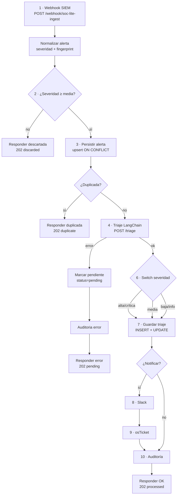

# 5. Flujo de nodos n8n

> Workflow importable: [`n8n/soc_lite_triage_workflow.json`](../n8n/soc_lite_triage_workflow.json)
> · 21 nodos (10 operativos + soporte) · importado y validado en `n8nio/n8n:latest`.

---

## 5.1 Por qué n8n

| Necesidad | Cómo la cubre n8n |
|---|---|
| Integrar Wazuh, OPNsense, PostgreSQL, HTTP, Slack y osTicket | Nodos nativos + HTTP Request |
| Reintentos y manejo de errores | `retryOnFail`, `maxTries`, salidas de error, `onError` |
| Visibilidad para operación | Ejecuciones, items de entrada/salida y editor visual |
| Cambios sin desplegar código | Versionado del JSON + importación |
| Idempotencia | `ON CONFLICT` en PostgreSQL + fingerprint |
| Bajo coste | Open source, autoalojado |

n8n **no** clasifica: sólo orquesta. El razonamiento vive en LangChain y la validación/persistencia
de negocio en FastAPI.

---

## 5.2 Los 10 nodos requeridos y su implementación

| # | Nodo (diseño) | Nodo real | Tipo | Función | Entrada | Salida |
|---|---|---|---|---|---|---|
| 1 | Webhook | **Webhook SIEM** | `webhook` | Recibe Wazuh/OPNsense | JSON crudo | `body` normalizable |
| 2 | IF | **Severidad minima** + **Duplicada** | `if` (2 nodos) | Descarta `< medium`; detecta duplicado | `severity`, `deduplicated` | Rama true/false |
| 3 | PostgreSQL | **Persistir alerta** | `postgres` | Upsert con fingerprint | payload normalizado | `id`, `severity`, `deduplicated` |
| 4 | HTTP Request | **Triaje LangChain** | `httpRequest` | Llama al microservicio | alerta normalizada | JSON de triaje |
| 5 | Agente LangChain | **Microservicio `/triage`** | servicio externo | Enriquece + clasifica | alerta + tools | `verdict`, `severity`, `actions` |
| 6 | Switch | **Switch severidad** | `switch` | Enruta por severidad | `severity` | 3 salidas |
| 7 | PostgreSQL | **Guardar triaje** | `postgres` | Inserta triaje y actualiza alerta | JSON del agente | `alert_id`, `status` |
| 8 | Slack/Telegram | **Slack** | `httpRequest` | Notifica sólo alta/crítica | resumen | mensaje |
| 9 | HTTP Request | **osTicket** | `httpRequest` | Crea ticket | triaje | `ticket_id` |
| 10 | HTTP Request | **Auditoria** | `httpRequest` | Registra en bitácora | acción | `hash` |

### Nodos de soporte

| Nodo | Tipo | Para qué |
|---|---|---|
| **Normalizar alerta** | `code` | Mapea payload, calcula severidad, tags y fingerprint |
| **Preparar guardado** | `code` | Empaqueta el triaje en base64 (un solo parámetro SQL) |
| **Notificar** | `if` | Sólo `high`/`critical` |
| **Marcar pendiente** | `postgres` | Si LangChain falla, deja la alerta `pending` |
| **Auditoria error** | `httpRequest` | Audita el fallo de triaje |
| **Responder OK / duplicada / descartada / error** | `respondToWebhook` | Respuesta HTTP al SIEM |
| **Nota de arquitectura / enrutamiento** | `stickyNote` | Documentación dentro del lienzo |

---

## 5.3 Grafo del workflow



---

## 5.4 Paso a paso

### Nodo 1 · Webhook SIEM

- **Tipo:** `n8n-nodes-base.webhook` v2.
- **Configuración:** `httpMethod=POST`, `path=soc-lite-ingest`, `responseMode=responseNode`.
- **Entrada:** JSON de Wazuh (`rule`, `agent`, `data`) o de OPNsense.
- **Salida:** item con `body`.
- **Seguridad:** el webhook queda en la red interna; en producción se publica detrás de Nginx con
  TLS y allowlist de IPs del SIEM.

```json
{
  "parameters": {
    "httpMethod": "POST",
    "path": "soc-lite-ingest",
    "responseMode": "responseNode",
    "options": { "rawBody": false }
  },
  "type": "n8n-nodes-base.webhook",
  "typeVersion": 2
}
```

### Nodo 2 · Normalizar alerta (Code)

Extrae los campos comunes, calcula severidad y construye una huella SHA-256 en ventana de 15 min.

```js
const body = $json.body ?? $json;
const rule = body.rule ?? {};
const data = body.data ?? {};
const level = Number(rule.level ?? 0);

let severity = body.severity;
if (!severity) severity = level >= 12 ? 'critical' : level >= 10 ? 'high'
  : level >= 7 ? 'medium' : level >= 4 ? 'low' : 'info';

const srcIp = data.srcip ?? body.src_ip ?? null;
const srcIpNorm = srcIp ?? '';
const fingerprint = require('crypto').createHash('sha256')
  .update([source, ruleId, srcIpNorm, dstIp ?? '', externalId, window].join('|'))
  .digest('hex');

return [{ json: { ...record, passes_filter: ['critical','high','medium'].includes(severity),
                  payload_b64: Buffer.from(JSON.stringify(record)).toString('base64') } }];
```

- **Salida:** `severity`, `tags` (pipe-separated), `fingerprint`, `payload_b64`, `passes_filter`.

### Nodo 3 · ¿Severidad ≥ media? (IF)

- **Condiciones (OR):** `severity == critical`, `high`, `medium`.
- **True:** persiste y tria.
- **False:** responde `202 discarded` sin tocar la base (ahorro de almacenamiento y ruido).

```json
{
  "conditions": {
    "options": { "caseSensitive": true, "typeValidation": "loose", "version": 2 },
    "conditions": [
      { "leftValue": "={{ $json.severity }}", "rightValue": "critical",
        "operator": { "type": "string", "operation": "equals" } },
      { "leftValue": "={{ $json.severity }}", "rightValue": "high",
        "operator": { "type": "string", "operation": "equals" } },
      { "leftValue": "={{ $json.severity }}", "rightValue": "medium",
        "operator": { "type": "string", "operation": "equals" } }
    ],
    "combinator": "or"
  }
}
```

### Nodo 4 · Persistir alerta (PostgreSQL)

Un solo parámetro base64 evita problemas de comas en descripciones y payloads.

```sql
INSERT INTO alerts (
    external_id, source, rule_id, rule_level, description, src_ip, dst_ip, dst_port,
    protocol, agent_name, asset_criticality, severity, status, fingerprint, raw_payload,
    tags, occurred_at, received_at, last_seen_at
)
SELECT
    NULLIF(x.external_id,''), x.source, NULLIF(x.rule_id,''), x.rule_level, x.description,
    NULLIF(x.src_ip,'')::inet, NULLIF(x.dst_ip,'')::inet, x.dst_port, x.protocol,
    x.agent_name, COALESCE(x.asset_criticality,3), x.severity::severity_level, 'pending',
    x.fingerprint, x.raw_payload, string_to_array(COALESCE(x.tags,''),'|'),
    COALESCE(NULLIF(x.occurred_at,'')::timestamptz, now()), now(), now()
FROM jsonb_to_record(convert_from(decode($1,'base64'),'UTF8')::jsonb) AS x(
    external_id text, source text, rule_id text, rule_level smallint, description text,
    src_ip text, dst_ip text, dst_port integer, protocol text, agent_name text,
    asset_criticality smallint, severity text, fingerprint text, raw_payload jsonb,
    tags text, occurred_at text
)
ON CONFLICT (fingerprint) DO UPDATE
   SET dedup_count = alerts.dedup_count + 1,
       last_seen_at = now()
RETURNING id, severity, (xmax <> 0) AS deduplicated;
```

- **Salida:** `id`, `severity`, `deduplicated`.
- **Idempotencia:** `ON CONFLICT` atómico; dos webhooks simultáneos no crean duplicados.
- **`xmax <> 0`:** detecta si fue `UPDATE` (duplicado) o `INSERT` (nuevo).

### Nodo 5 · ¿Duplicada? (IF)

- **Condición:** `deduplicated == true`.
- **True:** responde `202 duplicate`; no se vuelve a triar (evita coste de LLM).
- **False:** llama al triaje.

### Nodo 6 · Triaje LangChain (HTTP Request)

- **Método:** `POST`.
- **URL:** `{{$env.LANGCHAIN_URL}}/triage` (default `http://triage:8001/triage`).
- **Body:** alerta normalizada + `alert_id` de PostgreSQL.
- **Reintentos:** 2 intentos, 2 s de espera.
- **Timeout:** 60 s.
- **Salida OK:** `verdict`, `severity`, `confidence`, `summary`, `recommended_actions`,
  `mitre_techniques`, `model`, `prompt_version`, `latency_ms`, `status`, `fallback_used`.
- **Salida error:** conectada a **Marcar pendiente**.

```json
{
  "method": "POST",
  "url": "={{ $env.LANGCHAIN_URL || 'http://langchain:8001' }}/triage",
  "sendBody": true,
  "specifyBody": "json",
  "jsonBody": "={{ JSON.stringify({ alert_id: $('Persistir alerta').item.json.id, description: $('Normalizar alerta').item.json.description, src_ip: $('Normalizar alerta').item.json.src_ip, severity: $('Normalizar alerta').item.json.severity }) }}",
  "options": { "timeout": 60000 }
}
```

### Nodo 7 · Agente LangChain (servicio)

No es un nodo de n8n: es el microservicio el que ejecuta el agente con tool calling. n8n sólo ve el
contrato HTTP. Si el servicio está caído, n8n no inventa un veredicto: marca la alerta pendiente.

### Nodo 8 · Switch severidad

- **Tipo:** `switch` v3, tres salidas nombradas.
- **Regla 1 (Alta/Crítica):** `severity == critical OR high`.
- **Regla 2 (Media):** `severity == medium`.
- **Regla 3 (Baja/Info):** `severity == low OR info`.
- Las tres salidas convergen en **Preparar guardado**; el enrutamiento determina notificación, no
  persistencia.

### Nodo 9 · Preparar guardado (Code)

Empaqueta el triaje en JSON base64 y conserva `alert_id`, `severity`, `verdict` para los nodos
posteriores.

```js
const t = $json;
const alertId = $('Persistir alerta').item.json.id;
const payload = {
  alert_id: alertId,
  verdict: t.verdict ?? 'inconclusive',
  severity: t.severity ?? 'medium',
  confidence: Number(t.confidence ?? 0.5),
  summary: String(t.summary ?? 'Triaje sin resumen').slice(0, 1200),
  reasoning: t.reasoning ?? null,
  recommended_actions: t.recommended_actions ?? [],
  mitre_techniques: t.mitre_techniques ?? [],
  model: t.model ?? 'langchain',
  prompt_version: t.prompt_version ?? 'v1.2.0',
  latency_ms: Number(t.latency_ms ?? 0),
  status: t.status ?? 'completed',
  needs_human: Boolean(t.needs_human),
  fallback_used: Boolean(t.fallback_used),
  raw_response: t,
};
return [{ json: { alert_id: alertId, severity: payload.severity, verdict: payload.verdict,
  summary: payload.summary, status: payload.status,
  payload_b64: Buffer.from(JSON.stringify(payload)).toString('base64') } }];
```

### Nodo 10 · Guardar triaje (PostgreSQL)

CTE atómica: inserta el triaje y actualiza la alerta en una sola sentencia.

```sql
WITH payload AS (
    SELECT convert_from(decode($1,'base64'),'UTF8')::jsonb AS j
), ins AS (
    INSERT INTO triage_results (
        alert_id, verdict, severity, confidence, summary, reasoning, recommended_actions,
        mitre_techniques, model, prompt_version, latency_ms, status, needs_human,
        fallback_used, raw_response, triaged_at
    )
    SELECT
        (j->>'alert_id')::uuid, (j->>'verdict')::triage_verdict,
        (j->>'severity')::severity_level, COALESCE((j->>'confidence')::numeric,0.5),
        j->>'summary', j->>'reasoning',
        COALESCE(j->'recommended_actions','[]'::jsonb),
        COALESCE(ARRAY(SELECT jsonb_array_elements_text(j->'mitre_techniques')), ARRAY[]::text[]),
        j->>'model', j->>'prompt_version', COALESCE((j->>'latency_ms')::int,0),
        COALESCE(NULLIF(j->>'status',''),'completed')::triage_status,
        COALESCE((j->>'needs_human')::boolean,false),
        COALESCE((j->>'fallback_used')::boolean,false),
        COALESCE(j->'raw_response','{}'::jsonb), now()
    FROM payload
    RETURNING alert_id, verdict, severity
)
UPDATE alerts a
   SET status = CASE
       WHEN ins.verdict = 'false_positive' THEN 'false_positive'::alert_status
       WHEN ins.verdict = 'true_positive' AND ins.severity IN ('critical','high')
            THEN 'escalated'::alert_status
       ELSE 'triaged'::alert_status
   END
  FROM ins
 WHERE a.id = ins.alert_id
RETURNING a.id, a.status;
```

### Nodo 11 · ¿Notificar? (IF)

- **Condición (OR):** severidad `critical` o `high`.
- **True:** Slack → osTicket → Auditoría.
- **False:** Auditoría directa (media/baja se registran, no se notifican).

### Nodo 12 · Slack

- **Método:** `POST` al webhook de Slack (`$env.SLACK_WEBHOOK_URL`).
- **Mensaje:** severidad, resumen del LLM, veredicto y activo.
- **Fallo:** `onError=continueRegularOutput`; una caída de Slack no bloquea el pipeline.

### Nodo 13 · osTicket / Redmine

- **Método:** `POST {OSTICKET_URL}/api/v1/tickets`.
- **Cabecera:** `Authorization: Bearer $OSTICKET_TOKEN`.
- **Body:** asunto, `alert_id`, prioridad y resumen.
- **Fallo:** continuar; el incidente local ya existe y puede reintentarse.

### Nodo 14 · Auditoría

- **Método:** `POST {SOCLITE_API_URL}/api/v1/audit/events`.
- **Cabecera:** `X-Ingest-Key`.
- **Body:** `module=triage`, `action=TRIAGE_COMPLETED`, `entity_id=alert_id`, veredicto, severidad,
  estado y workflow.
- **Efecto:** inserta en `audit_log` con hash chain.

### Nodo 15 · Responder OK

```json
{"status": "processed", "alert_id": "…", "verdict": "true_positive", "severity": "critical"}
```

### Ruta de error

1. **Marcar pendiente:** `UPDATE alerts SET status='pending' WHERE id=$1::uuid RETURNING id,status`.
2. **Auditoria error:** `action=TRIAGE_FAILED`, `result=failure`, motivo `microservicio LangChain no
   disponible`.
3. **Responder error:** `202 {status:"pending", reason:"triaje no disponible"}`.

Así el SIEM no reintenta indefinidamente y el analista ve la alerta en la cola.

---

## 5.5 Manejo de errores, reintentos e idempotencia

| Situación | Comportamiento |
|---|---|
| Payload inválido | Code node lanza error; n8n registra la ejecución fallida (revisar manualmente) |
| Severidad baja | Se descarta con `202` y no se persiste |
| Duplicado en 15 min | `dedup_count++`, `202 duplicate`, sin LLM |
| LangChain timeout/500 | 2 reintentos → `pending` + auditoría de fallo |
| Slack/osTicket caídos | `onError=continueRegularOutput`; se conserva el triaje |
| PostgreSQL caído | Nodo falla; n8n reintenta según configuración global; alerta se recupera al reprocesar |
| Ejecución duplicada | `fingerprint` único + `ON CONFLICT`; el triaje no se duplica si se detecta duplicado |
| Webhook repetido por el SIEM | Misma huella → duplicado |

**Recomendación:** configurar un workflow de error global de n8n (`Error Trigger`) que envíe a
Slack/auditoría las ejecuciones fallidas y permita reprocesar el `executionId`. No se incluye en
este JSON para no acoplar credenciales; el flujo principal ya cubre el fallo de triaje.

---

## 5.6 Instalación y activación

1. **Importar:** n8n → *Workflows* → *Import from File* →
   `n8n/soc_lite_triage_workflow.json`.
2. **Credencial PostgreSQL:** crear `SOC-Lite PostgreSQL` con host `db`, puerto `5432`, base
   `soclite`, usuario/clave del `.env`. Asignarla a **Persistir alerta**, **Guardar triaje** y
   **Marcar pendiente**.
3. **Variables de entorno del contenedor n8n:**

   ```env
   LANGCHAIN_URL=http://triage:8001
   SOCLITE_API_URL=http://backend:8000
   SOCLITE_INGEST_KEY=<misma que INGEST_API_KEY>
   SLACK_WEBHOOK_URL=https://hooks.slack.com/services/...
   OSTICKET_URL=https://osticket.local
   OSTICKET_TOKEN=...
   ```

4. **Activar** el workflow (toggle *Active*).
5. **URL del webhook:** `http://<host>:5679/webhook/soc-lite-ingest`.
6. **Probar:**

   ```bash
   curl -i -X POST http://localhost:5679/webhook/soc-lite-ingest \
     -H 'Content-Type: application/json' \
     -d '{"id":"n8n-demo-1","rule":{"id":"5710","level":12,"description":"Fuerza bruta SSH"},
          "agent":{"name":"SRV-WEB01"},"data":{"srcip":"203.0.113.44","dstip":"10.0.4.21"}}'
   ```

   Respuesta esperada: `202` con `{"status":"processed","verdict":"...","severity":"..."}`.

### Configurar Wazuh

En el manager, una integración `custom-*` o un `<integration>` que ejecute un script/HTTP hacia el
webhook. Alternativa sin tocar Wazuh: usar el endpoint de ingesta de FastAPI
(`POST /api/v1/alerts/ingest` con `X-Ingest-Key`) y dejar que n8n consuma la cola por polling.

---

## 5.7 Operación y diagnóstico

| Síntoma | Causa probable | Acción |
|---|---|---|
| `202 duplicate` constante | Ventana de dedup muy amplia | Ajustar `fingerprint`/ventana o excluir `external_id` |
| `pending` tras cada alerta | LangChain caído | Revisar `docker logs soclite-triage`, `/health` |
| No llega a Slack | Webhook inválido o `onError` silencioso | Revisar ejecución y `SLACK_WEBHOOK_URL` |
| Error de credencial PostgreSQL | Credencial no asignada | Asignar en los 3 nodos |
| SQL error en `Guardar triaje` | Esquema desactualizado | Aplicar `db/schema.sql` |
| Respuesta vacía al SIEM | `responseMode` mal configurado | Debe ser `responseNode` y existir un Respond |

**Reprocesar:** en n8n, abrir la ejecución fallida → *Retry* (si se guardó el payload) o reenviar
el JSON desde el SIEM. La idempotencia evita duplicados.

---

## 5.8 Validación realizada

| Prueba | Resultado |
|---|---|
| Importación en `n8nio/n8n:latest` | ✅ 21 nodos importados |
| Exportación posterior y comparación de tipos | ✅ Webhook v2, IF v2.2, Switch v3, Postgres v2.4, HTTP v4.2 |
| `INSERT` de alerta contra PostgreSQL real | ✅ devuelve `id`, `severity`, `deduplicated` |
| `INSERT` de triaje + `UPDATE` de alerta | ✅ devuelve `id`, `status` |
| Ejecución E2E con credenciales | ⚠️ No ejecutada en este entorno (requiere crear credencial y variables) |

La limitación es de **configuración**, no de diseño: el workflow importa y el SQL es válido. Para
una demo completa, seguir §5.6 y verificar la respuesta del webhook.
