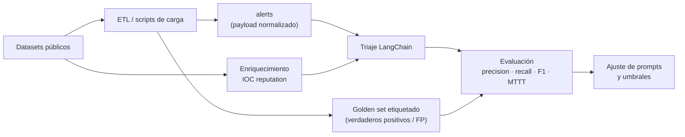

# 6. Datasets públicos recomendados

> Para entrenar, evaluar y demostrar SOC-Lite sin usar datos reales de la organización.
> **Verificar siempre la licencia y los términos de uso antes de incorporarlos a un producto.**

---

## 6.1 Cómo encajan en la arquitectura



SOC-Lite necesita tres tipos de datos:

1. **Datos de ingesta** (logs/alertas) para probar el pipeline y el dashboard.
2. **Datos etiquetados** (malicioso/benigno) para medir la calidad del triaje.
3. **Datos de reputación** (IPs, dominios, hashes) para enriquecer y simular proveedores.

---

## 6.2 Datasets de red e intrusiones

| Dataset | Contenido | Formato / tamaño | Acceso y licencia | Uso en SOC-Lite | Prioridad |
|---|---|---|---|---|---|
| **CICIDS2017** — Canadian Institute for Cybersecurity | Tráfico benigno + ataques (DoS, brute force, web, infiltración, botnet), con etiquetas por flujo | CSV/PCAP, ~3 M flujos | [unb.ca/cic/datasets/ids-2017.html](https://www.unb.ca/cic/datasets/ids-2017.html) · formulario, uso académico | Generar alertas de red y evaluar detección; mapear a reglas Wazuh/Suricata | Muy alta |
| **CSE-CIC-IDS2018** | Similar a 2017, con ataques más variados y entorno AWS | CSV/PCAP, ~16 M flujos | [unb.ca/cic/datasets/ids-2018.html](https://www.unb.ca/cic/datasets/ids-2018.html) · AWS Open Data | Pruebas de volumen y MTTT | Alta |
| **NSL-KDD** | Versión depurada de KDD'99, 4 categorías de ataque | CSV, ~150 k registros | [unb.ca/cic/datasets/nsl.html](https://www.unb.ca/cic/datasets/nsl.html) · uso académico | Baseline clásico y comparación | Media |
| **UNSW-NB15** | 9 tipos de ataque modernos + tráfico normal, features de flujo | CSV/PCAP, ~2.5 M | [research.unsw.edu.au/projects/unsw-nb15-dataset](https://research.unsw.edu.au/projects/unsw-nb15-dataset) · académico | Evaluación de clasificadores y reglas | Alta |
| **AIT Log Data Set v2** | Logs reales de un entorno empresarial con ataques etiquetados (Linux/Windows) | JSON/CSV, ~1.5 M eventos | [ait.ac.at](https://www.ait.ac.at/en/research-topics/cyber-security/ait-security-datasets) · solicitud, investigación | Ingesta tipo Wazuh y evaluación de correlación | Muy alta |
| **CIC IoT Dataset 2023** | Tráfico IoT con 33 ataques | CSV/PCAP | [unb.ca/cic/datasets/iotdataset-2023.html](https://www.unb.ca/cic/datasets/iotdataset-2023.html) · académico | Casos de IoT para PYME | Media |
| **MAWILab** | Trazas de backbone con anomalías etiquetadas | PCAP/CSV | [fukuda-lab.org/mawilab](https://www.fukuda-lab.org/mawilab/) · abierto | Detección de anomalías de red | Baja |
| **Kyoto 2006+** | Honeypot + tráfico normal etiquetado | CSV | [takakura.com/Kyoto_data](https://www.takakura.com/Kyoto_data/) · abierto | Experimentos de FP | Baja |

---

## 6.3 Datos de endpoint, SIEM y SOC

| Dataset | Contenido | Formato | Acceso y licencia | Uso en SOC-Lite | Prioridad |
|---|---|---|---|---|---|
| **Mordor** — OTRF | Eventos de endpoint/Sysmon, PowerShell, cmd, red, con escenarios ATT&CK | JSON (EVTX convertido), GB | [github.com/OTRF/mordor](https://github.com/OTRF/mordor) · Apache-2.0 | Simular alertas de endpoint y MITRE | Muy alta |
| **Security-Datasets** — OTRF | Colección curada de datasets de seguridad con metadatos ATT&CK | JSON/EVTX | [github.com/OTRF/Security-Datasets](https://github.com/OTRF/Security-Datasets) · Apache-2.0 | Reproducir ataques y evaluar mapeo MITRE | Muy alta |
| **Splunk Attack Data** | Datos de ataque reproducibles, mapeados a ATT&CK, múltiples fuentes | JSON/EVTX/PCAP | [github.com/splunk/attack_data](https://github.com/splunk/attack_data) · Apache-2.0 | Ingesta masiva y pruebas de regresión | Muy alta |
| **EVTX-ATTACK-SAMPLES** | Muestras EVTX de técnicas ATT&CK | EVTX | [github.com/sbousseaden/EVTX-ATTACK-SAMPLES](https://github.com/sbousseaden/EVTX-ATTACK-SAMPLES) · verificar licencia | Pruebas de parsing y detección Windows | Alta |
| **BOTS v1/v2/v3** — Splunk | Datasets de "Boss of the SOC" con logs de múltiples fuentes | JSON/CSV, GB | [github.com/splunk/botsv1](https://github.com/splunk/botsv1) y variantes · uso educativo | Simulación SOC completa, hunting y triaje | Muy alta |
| **LogHub** | 19+ datasets de logs (HDFS, Linux, Apache, Windows, etc.) | CSV/JSON | [github.com/logpai/loghub](https://github.com/logpai/loghub) · investigación | Pruebas de parsing y volumen | Media |
| **Wazuh ruleset + samples** | Reglas y ejemplos de alertas | XML/JSON | [github.com/wazuh/wazuh](https://github.com/wazuh/wazuh) · GPL-2.0 | Validar el normalizador y niveles | Alta |
| **Atomic Red Team** | Pruebas atómicas por técnica ATT&CK | YAML/scripts | [github.com/redcanaryco/atomic-red-team](https://github.com/redcanaryco/atomic-red-team) · MIT | Generar telemetría propia en laboratorio | Alta |

> **BOTS** es especialmente útil para SOC-Lite: incluye datos de servidores web, firewalls,
> endpoints y correo, y escenarios de investigación que se parecen a la operación real de una PYME.

---

## 6.4 Threat intelligence y reputación

| Fuente | Contenido | Acceso / API | Uso en SOC-Lite | Licencia |
|---|---|---|---|---|
| **VirusTotal** | Reputación de IP/dominio/hash/URL | API v3 (clave gratuita limitada) | Tool `virustotal` del agente | Términos de VirusTotal; no redistribuir |
| **AbuseIPDB** | Reportes de abuso por IP, score 0–100 | API v2 (clave gratuita) | Tool `abuseipdb` | Términos; atribución |
| **AlienVault OTX** | Indicadores y pulsos comunitarios | API / descargas | Enriquecimiento y datasets de IOC | Apache-2.0 (verificar por pulso) |
| **URLhaus** (abuse.ch) | URLs de distribución de malware | CSV/JSON diario | Enriquecimiento de URLs/dominios | CC0 / términos abuse.ch |
| **MalwareBazaar** (abuse.ch) | Muestras y hashes de malware | API/CSV | Hash reputation, laboratorio aislado | Términos abuse.ch |
| **Feodo Tracker** (abuse.ch) | IPs de C2 de botnets | CSV/JSON | Bloqueo y detección | CC0 |
| **PhishTank** | URLs de phishing verificadas | CSV/API | Casos de phishing | Términos, atribución |
| **MITRE ATT&CK** | Técnicas, tácticas, grupos, software | STIX/JSON | Mapeo de técnicas y reportes | Términos MITRE, uso libre con atribución |
| **CISA KEV** | Vulnerabilidades explotadas conocidas | JSON/CSV | Priorización de vulnerabilidades (caso futuro) | Dominio público |
| **NVD / CVE** | Vulnerabilidades y CVSS | API/JSON | Módulo de vulnerabilidades | NIST, uso libre |

**Regla de oro:** no envíes el payload completo a estos proveedores; SOC-Lite sólo consulta el
indicador (IP/dominio/hash). Las claves se leen de variables de entorno y nunca se almacenan en la
base.

---

## 6.5 Datasets para evaluar el LLM

No existe un dataset público específico de "triaje SOC en español" con calidad suficiente. Se
recomienda **construir un golden set propio** a partir de los anteriores:

| Estrategia | Descripción | Esfuerzo |
|---|---|---|
| Muestreo estratificado de BOTS/Mordor | 200–500 alertas con etiqueta humana (TP/FP/sospechoso/benigno) | Medio |
| Inyección de casos sintéticos | Variantes de las 8 historias curadas, con cambios de IP/activo/descripción | Bajo |
| Adjudicación doble | Dos analistas etiquetan a ciegas; un tercero resuelve discrepancias | Alto |
| Datos de la organización | Alertas históricas ya cerradas, anonimizadas | Alto (privacidad) |

**Formato sugerido (JSONL):**

```json
{"alert_id":"gold-001","source":"wazuh","rule_level":12,"description":"Fuerza bruta SSH...",
 "src_ip":"203.0.113.44","asset_criticality":5,
 "expected_verdict":"true_positive","expected_severity":"critical",
 "expected_mitre":["T1110"],"notes":"IP con 100% AbuseIPDB"}
```

**Métricas:**

| Métrica | Fórmula | Objetivo inicial |
|---|---|---|
| Precision (TP) | TP / (TP + FP) | > 0.80 |
| Recall (TP) | TP / (TP + FN) | > 0.85 |
| F1 | 2PR / (P + R) | > 0.82 |
| Tasa de FP | FP / total | < 15 % |
| Cobertura | alertas con veredicto / total | > 95 % |
| MTTT | mediana y P95 | < 30 / 60 min |
| Acuerdo con humano | Cohen's kappa | > 0.70 |

**Advertencia:** usar un LLM como juez introduce sesgo. La evaluación final debe ser humana y
ciega al modelo; el LLM sólo sirve para pre-etiquetar y detectar casos raros.

---

## 6.6 Cómo cargar los datasets en SOC-Lite

### 6.6.1 Alertas normalizadas

Los datasets de red vienen como flujos, no como alertas. El pipeline recomendado es:

```text
PCAP/CSV → Suricata/Zeek o script ETL → JSON con forma Wazuh → POST /api/v1/alerts/ingest
```

Script de ejemplo (Python + pandas) para convertir CICIDS a alertas:

```python
import pandas as pd, requests, uuid

API = "http://localhost:8010/api/v1/alerts/ingest"
KEY = "dev-ingest-key-change-me"

df = pd.read_csv("cicids2017.csv").sample(500, random_state=42)
for _, row in df.iterrows():
    payload = {
        "id": f"cic-{uuid.uuid4().hex[:8]}",
        "source": "suricata",
        "rule": {"id": "CIC-001", "level": 10 if row["Label"] != "BENIGN" else 3,
                 "description": f"Flujo {row['Label']} hacia {row['Destination IP']}"},
        "agent": {"name": "LAB-SENSOR", "criticality": 3},
        "data": {"srcip": row["Source IP"], "dstip": row["Destination IP"],
                 "dstport": int(row["Destination Port"]), "protocol": row["Protocol"].lower()},
    }
    requests.post(API, json=payload, headers={"X-Ingest-Key": KEY}, timeout=10)
```

> Anonimizar IPs reales con rangos de documentación (RFC 5737: `192.0.2.0/24`,
> `198.51.100.0/24`, `203.0.113.0/24`) antes de cargar datos de producción.

### 6.6.2 Evaluación del triaje

1. Cargar 200–500 alertas del golden set con `external_id` único.
2. Ejecutar `POST /alerts/{id}/triage` para cada una (script con concurrencia limitada).
3. Comparar `triage_results.verdict` / `severity` contra la etiqueta.
4. Calcular la matriz de confusión y las métricas; registrar `model` y `prompt_version`.
5. Repetir al cambiar de modelo o prompt; comparar.

### 6.6.3 Enriquecimiento simulados

Para pruebas sin claves de API, usar los CSV de URLhaus/Feodo como un "proveedor local":

```python
# pseudo-tool para tests
def lookup_local(ip: str) -> dict:
    row = feodo_df[feodo_df["dst_ip"] == ip]
    return {"provider": "feodo", "verdict": "malicious" if len(row) else "unknown", "score": 90}
```

SOC-Lite ya soporta `provider=internal` en `enrichment_data`; se puede cargar una tabla de IOCs
conocidos y consultarla antes de salir a Internet.

---

## 6.7 Licencias y privacidad

| Aspecto | Recomendación |
|---|---|
| Uso comercial | CIC/UNSW/AIT suelen ser sólo investigación; solicitar permiso explícito |
| Atribución | Citar autores y papers en la documentación y en la UI si se muestran resultados |
| Redistribución | No redistribuir PCAP/EVTX con datos personales; publicar sólo el script de descarga |
| Datos personales | Anonimizar IPs, usuarios, dominios y hashes de archivos personales |
| Términos de API | Respetar cuotas de VirusTotal/AbuseIPDB; cachear con TTL |
| Modelos | Verificar la licencia del modelo Ollama (Llama 3.1 tiene su propia licencia comunitaria) |
| Retención | No conservar más de lo necesario; TTL en `enrichment_data` |

---

## 6.8 Prioridad de descarga recomendada

| Orden | Dataset | Por qué |
|---|---|---|
| 1 | **BOTS v1** | Logs multi-fuente y escenarios SOC listos para triaje |
| 2 | **Mordor / Security-Datasets** | Endpoint + ATT&CK, excelente para el agente |
| 3 | **CICIDS2017** | Volumen y etiquetas de red para probar ingesta y métricas |
| 4 | **AIT Log Data Set v2** | Logs empresariales realistas para Wazuh |
| 5 | **URLhaus / Feodo / OTX** | Reputación para enriquecimiento y pruebas offline |
| 6 | **MITRE ATT&CK STIX** | Mapeo de técnicas y reportes |
| 7 | **Splunk Attack Data** | Regresión amplia cuando el pipeline ya funciona |

Con **BOTS + Mordor + CICIDS** se puede demostrar el 90 % de las capacidades de SOC-Lite sin
tocar datos reales. El 10 % restante (política, activos internos, contexto del negocio) requiere
datos de la organización y un proceso de anonimización.
